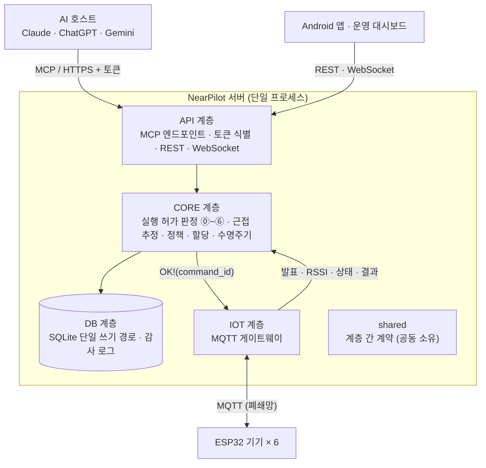
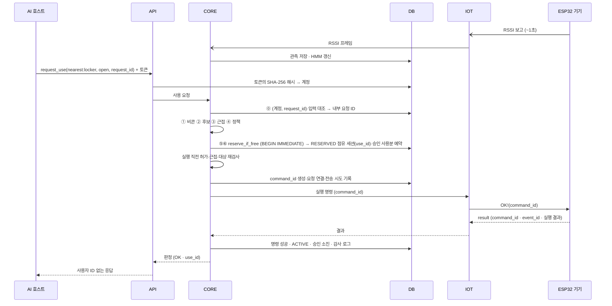
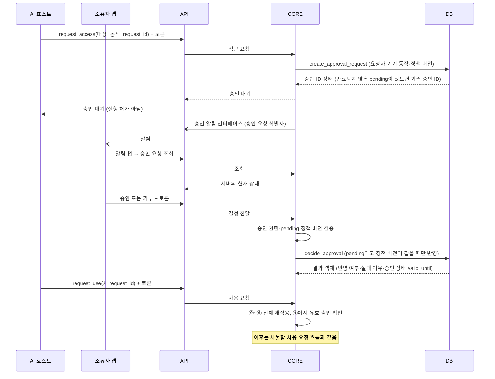

# 아키텍처

<!--
이 문서는 "영역은 어떻게 나뉘고 어떻게 연결되는가"에 답한다.
쓰는 것: 영역, 디렉터리, 담당, 의존 관계, 영역 간 계약, 외부 계약, 데이터 계약, 영역을 넘는 흐름, 기술 스택
쓰지 않는 것: 영역 내부 구조 (spec과 코드), 요구사항 (requirements.md)
이 문서에는 제공 영역, 사용 영역, 약속과 외부 메시지 형식을 쓴다.
shared의 시그니처는 계약 구현 때 맞춘다. 문서 반영만으로 코드 구현을 완료한 것으로 보지 않는다.
-->

## 1. 구성

서버는 API, CORE, DB, IOT의 4계층으로 구성한다. 4인의 역할은 **판정, 근접 추정, 상태 관리, DB**다. 계층 구조와 사람의 역할 분담은 서로 다르다.



| 계층 | 책임 | 관련 요구사항 |
|---|---|---|
| **API** | MCP Streamable HTTP 엔드포인트와 도구 6개, 토큰으로 계정 식별, 앱과 대시보드용 REST, 실시간 모니터링 WebSocket, 소유자 앱 승인 알림 전달, 응답에서 사용자 ID 제거 | FR-08, FR-09, FR-10, FR-11. 서버 측: FR-01, FR-03, FR-12A, FR-12B. NFR-01, NFR-07, NFR-08, NFR-09, NFR-11 |
| **CORE** | ⓪~⑥ 결정론적 판정, 실행 직전 재검사, 근접 추정 (관측 모델과 HMM), 재질문, 접근 정책과 승인, 전역 할당, 상태 머신, 해제, `FAULT` 복구 | FR-13~FR-21, FR-23, NFR-02, NFR-04, NFR-05, NFR-06 |
| **DB** | SQLite 스키마, 단일 쓰기 경로와 `BEGIN IMMEDIATE` 원자적 점유, 저장소 조회, 감사 로그 (테이블과 JSONL), 공개용 데이터셋 추출 | FR-19 (원자성), FR-22, NFR-03, NFR-13 |
| **IOT** | MQTT 브로커 연결, 기기 발견, RSSI, 상태, 실행 결과, 반납 검사 결과의 수신과 검증, 실행 명령 전송과 결과 대기 (타임아웃), 반납 검사 요청 전송, 기기별 자격정보, 기기 시뮬레이터 | 서버 측: FR-04~FR-07. NFR-08, NFR-10, NFR-12, 지표 8 수집 데이터의 수신과 검증 |
| **shared** | 계층 사이에서 오가는 데이터 모델, 열거형, 인터페이스의 정의. 4인이 공동으로 소유한다. | FR-09, FR-18, FR-19 |

## 2. 영역과 담당

### 디렉터리

```
nearpilot-server/
├── AGENTS.md                   에이전트 지침
├── CLAUDE.md                   AGENTS.md를 불러온다
├── docs/                       제품, 요구사항, 아키텍처, 문체와 용어
├── specs/                      작업 명세 specs/{계층}-{요약}/spec.md
│   └── _template/              spec 양식
├── .github/                    이슈 양식, PR 양식, CI
├── server/
│   ├── pyproject.toml
│   ├── src/nearpilot/
│   │   ├── shared/             계층 간 계약: 도메인 모델, 열거형, 인터페이스, 설정
│   │   ├── api/
│   │   │   ├── mcp/            MCP 엔드포인트와 도구 6개 (FR-08~FR-11)
│   │   │   ├── auth/           토큰으로 계정 식별, 무효 토큰 거부
│   │   │   ├── rest/           앱(계정, 승인)과 대시보드(신뢰, 정책, 복구)용 API
│   │   │   └── ws/             실시간 모니터링 (FR-12B)
│   │   ├── core/
│   │   │   ├── decision/       ⓪~⑥ 판정 파이프라인 (FR-15, FR-18)
│   │   │   ├── proximity/      관측 모델, HMM, 재질문 임계값 (FR-16, FR-17)
│   │   │   ├── policy/         접근 정책과 승인 검사 (FR-14)
│   │   │   ├── allocation/     전역 할당 (FR-23)
│   │   │   └── lifecycle/      상태 머신, 명시적 해제, 초과시간 계산, FAULT 복구 (FR-19, FR-20, NFR-04)
│   │   ├── db/
│   │   │   ├── schema/         DDL과 마이그레이션
│   │   │   ├── repositories/   테이블별 저장소와 원자적 점유
│   │   │   └── audit/          감사 로그 (FR-22)
│   │   └── iot/
│   │       ├── mqtt/           브로커 연결, 구독, 명령 전송
│   │       └── messages/       MQTT 페이로드 스키마 (펌웨어와의 계약)
│   ├── tests/
│   │   ├── api/ core/ db/ iot/ shared/    계층별 단위 테스트
│   │   └── integration/        계층을 합친 시나리오 테스트
│   └── tools/
│       ├── node_sim/           가상 ESP32 기기 (하드웨어 없이 개발과 부하 시험)
│       ├── data_collection/    RSSI 라벨 수집 (지표 8)
│       └── evaluation/         지표 1~9 평가 표와 그래프 생성 (NFR-13)
├── app/                        Android 앱 (비콘 송출, 알림)
├── dashboard/                  운영 대시보드 (웹)
└── firmware/                   ESP32 기기 펌웨어
```

### 담당

표의 경로는 `server/` 기준이다. 테스트는 `tests/` 아래 같은 이름의 폴더에 둔다.

| 역할 | 담당 폴더 | 책임 |
|---|---|---|
| **판정** | `src/nearpilot/core/decision/`, `core/allocation/`, `api/mcp/`, `api/auth/` | 판정 ⓪~⑥ 조합, 근접, 정책, 점유 결과의 반영, 실행 직전 재검사, 전역 할당, MCP 도구 6개, 토큰으로 계정 식별, `CoreService`와 MCP 앱을 만드는 연결 함수 |
| **근접 추정** | `src/nearpilot/core/proximity/`, `tools/data_collection/` | 관측 모델과 HMM, 사후확률 계산, 근접 추정 인터페이스, 수집 회차와 라벨 기록 |
| **상태 관리** | `src/nearpilot/core/lifecycle/`, `iot/`, `tools/node_sim/` | 예약 뒤의 상태 전이, 대여 점유 유지와 초과시간 계산, 명시적 해제, `FAULT` 복구, MQTT 게이트웨이, 기기 시뮬레이터, CORE 쪽 `NodeEventSink`, 서버 실행 진입점과 CORE 서비스 조립 |
| **DB** | `src/nearpilot/db/`, `core/policy/`, `tools/evaluation/` | 스키마, 저장소, 원자적 점유와 승인 사용분, 감사 로그, 평가 스크립트, 접근 정책과 승인 검사, 토큰 해시로 계정 조회 (`AccountLookup`), 관리 쓰기 접점 (`AdminRepository`) |
| **공동** | `src/nearpilot/shared/`, `tests/integration/` | 계층 간 계약, 계층을 합친 시나리오 테스트 |

- 이 표는 역할별 담당 범위를 기록한다. 개인 이름은 쓰지 않는다.
- [#88](https://github.com/capstone-itda/nearpilot-server/issues/88)의 A안을 따른다. 상태 관리는 서버 실행 진입점과 조립 모듈을 만든다. 조립은 설정, DB 저장소, MQTT 게이트웨이와 CORE 서비스를 만들고 연결한다. 판정은 `CoreService`와 MCP 앱을 만드는 연결 함수만 제공한다. 진입점이 이 함수로 MCP 엔드포인트를 붙인다.
- 조립은 게이트웨이를 구독한 뒤, 요청을 받기 전에 재시작 복원을 한 번 실행한다. 모든 상태 관리 서비스에 같은 복구 서비스와 기기별 잠금을 주입한다. 반납 검사와 이탈 판단의 `tick()`을 주기적으로 호출한다.
- 미결: 진입점과 조립 모듈의 경로와 실행 명령. 상태 관리 spec에서 정한다.
- 미결: `api/rest/`와 `api/ws/`의 담당. 앱과 대시보드의 담당을 정할 때 함께 배정한다.
- 미결: 앱(`app/`)과 대시보드(`dashboard/`)의 담당. 서버 담당 업무를 먼저 마친 사람이 맡는다.
- 미결: 펌웨어(`firmware/`)의 담당과 IOT 구현의 담당 배정. 팀이 펌웨어 담당을 배정할 때 함께 정한다.

## 3. 의존 관계

```
api  ──▶  core  ──▶  db
            │  ◀──  iot      (iot → core 는 이벤트 전달, core → iot 는 실행 명령)
모든 계층 ──▶ shared
```

의존 규칙은 `AGENTS.md` "코딩 규칙"에 있다.

## 4. 영역 간 계약

| 계약 | 제공 | 사용 | 약속 |
|---|---|---|---|
| 저장소 인터페이스 | DB | CORE (API는 계정 식별만) | 계정과 비콘, 기기, 정책 이력과 승인 사용분, 외부 키와 내부 요청 ID와 명령 ID의 연결, 점유 세션, RSSI 관측, 원자적 점유와 승인 예약 (`reserve_if_free`). 판정은 대여형과 공용형 모두 `reserve_if_free` 하나로 예약한다. |
| 승인 저장 인터페이스 | DB | CORE | 접근 승인 요청을 저장한다 (`Repository.create_approval_request`). 소유자의 결정을 조건부로 반영한다 (`Repository.decide_approval`). 요청자·기기의 승인 이력을 조회한다 (`Repository.approvals_in_scope`). `FAULT` 복구의 소유자 승인에는 쓰지 않는다. |
| 판정 기록 인터페이스 | DB | CORE (판정) | 판정 한 건마다 판정과 `DecisionRecord`를 한 번 저장한다 (`Repository.save_decision`). |
| 계정 조회 인터페이스 | DB | API (`api/auth`) | `api/auth`가 토큰의 SHA-256 해시를 계산해서 넘긴다. DB는 저장한 해시와 비교해서 계정을 반환한다 (`AccountLookup.account_by_token_hash`). |
| 관리 쓰기 인터페이스 | DB | 관리 기능 (`AdminService`), 시드 스크립트, 수집 도구 (`tools/data_collection`) | 계정과 비콘 등록, 기기 신뢰 변경, 장소 배치, 정책 변경, 수집 회차 기록을 저장한다 (`AdminRepository`). 관리 API와 `AdminService`는 담당을 배정한 뒤 이 접점 위에 만든다. |
| 사건별 저장 인터페이스 | DB | CORE | 예약 이후의 명령 연결, 전송 시작, 미전송 취소, 실행 결과, 이상 격리, 종료를 사건마다 원자적으로 반영한다 (`ExecutionStore`). |
| 복원·복구 저장 인터페이스 | DB | CORE (상태 관리) | 재시작 복원 조회, 복구 건 저장과 조회, 복구 정산을 제공한다 (`restore_pending`, `save_recovery`, `recovery`, `settle_recovery`). |
| 복구 인터페이스 | CORE (상태 관리) | API | 복구 준비 조회와 복구 승인 요청을 따로 제공한다. 준비 판단, 재검사, 불명 결과 확인은 상태 관리가 맡는다. |
| 정책 검사 인터페이스 | DB (`core/policy`) | CORE (판정) | ④에서 계정, 확정한 기기, 동작, 현재 시각으로 정책과 승인을 검사한다 (`PolicyChecker.check`). 허용, 승인 필요, 거부와 사유, 적용한 정책 버전(정책이 없으면 없음), 승인 ID를 `PolicyCheckResult`로 반환한다. 정책 모드, 승인 범위, 정책 버전 비교 규칙은 이 접점 안에 둔다. 승인 필요 사유는 승인 이력으로 고른다. 상세는 아래 "승인 이력과 승인 필요 사유"에 있다. 승인 사용분 예약은 하지 않는다 (`reserve_if_free`). |
| 근접 추정 인터페이스 | 근접 추정 (`core/proximity`) | CORE (판정) | ③에서 비콘, 후보 기기, 시각으로 후보별 사후확률을 계산한다 (`ProximityEstimator.posterior`). 근접 추정은 장소의 전체 상태로 계산한 후보의 확률을 다시 정규화하지 않고 반환한다. `ProximityResult.posteriors`의 합은 1 이하다. 판정은 명시 지정 요청에도 ②의 전체 후보를 넘기고, 지정 대상을 인자로 넘기지 않는다. 판정이 `posteriors[지정 대상]`을 읽어 임계값과 비교한다. 임계값은 판정이 요청 종류에 따라 설정에서 고른다. 상세는 아래 "근접 사후확률의 범위"에 있다. |
| 감사 로그 인터페이스 | DB | CORE | 단계별 입력, 결과, 버전, 임계값, 후보 확률의 기록 (`AuditLog.append`). 감사 테이블이 원본이다. JSONL은 커밋한 행을 내보낸 사본이다. |
| 기기 명령 인터페이스 | IOT | CORE | `command_id`별로 전송과 결과를 추적한다. 확실한 미전송, 전송 뒤 성공, 전송 뒤 실패, 결과 불명을 구분한다. 시간 초과와 연결 끊김을 미실행으로 보지 않는다. 기기가 구동 전에 `DEVICE_BUSY`로 거부한 결과는 거부 상태와 사유를 그대로 전달한다 (§5 MQTT 5절). 접점은 `NodeCommandGateway.send`다. IOT는 CORE가 요청한 반납 검사를 `check_id`별로 기기에 보낸다. 접점은 `SafetyCheckGateway.request_check`다. |
| 기기 이벤트 인터페이스 | CORE | IOT | CORE는 기능 발표, RSSI 프레임, 원시 물리 관측, 실행 결과, 반납 검사 결과를 받는다 (`NodeEventSink`). IOT는 안전을 자체 판정하지 않는다. 반납의 종료는 CORE가 결정한다. |
| 기능 인터페이스 | CORE | API | MCP 도구 6개와 관리 기능 (계정 등록, 기기 신뢰, 정책, 승인, `FAULT` 복구) |
| 승인 알림 인터페이스 | API | CORE | 승인 대기가 생기면 CORE가 소유자 앱 알림을 요청한다. 요청에는 승인 요청 식별자를 담는다. 전달 실패는 승인 상태와 판정을 바꾸지 않는다. 전달 수단은 미결이다 (FR-03). |
| 도메인 모델·열거형 | 공동 | 전체 | 상태 값, 판정 결과 (`OK`, `BUSY`, `ASK`, `DENY`, `NEED_APPROVAL`), 사유 코드, 요청과 판정과 점유 세션의 값 객체 |

- 명령을 보내지 않은 것이 확실한 취소에만 CORE는 예약과 승인 사용분을 자동으로 반환한다.
- 전송을 시도한 뒤 결과가 실패하거나 불명이면 CORE는 불명확한 점유와 승인 사용분을 보류하고 기기를 `FAULT`로 둔다.
- 예외는 기기가 검증된 `DEVICE_BUSY`로 접수·실행 전에 거부한 명령 하나뿐이다. 약속은 "구동 중 추가 명령 제한의 저장"에 있다.
- IOT는 새 명령 ID로 자동 재시도하지 않는다.
- 실행 직전 재검사는 자기 요청의 예약을 경합으로 판정하지 않는다.
- 공용형 기기에는 시간에 따른 자동 꺼짐 타이머를 두지 않는다. 유지 대상자가 모두 이탈하면 CORE가 꺼짐을 요청한다 (FR-20).

### 실행 인계와 재검사

[#16](https://github.com/capstone-itda/nearpilot-server/issues/16)의 인계 계약, [#35](https://github.com/capstone-itda/nearpilot-server/issues/35)의 A안, [#79](https://github.com/capstone-itda/nearpilot-server/issues/79)의 A안과 [#80](https://github.com/capstone-itda/nearpilot-server/issues/80)의 B안을 따른다.
판정은 최초 허가와 필요한 예약 뒤 `context` 하나를 상태 관리에 전달한다.

| 정보 | 약속 |
|---|---|
| `internal_request_id` | 기존 요청과 실행 건을 찾는다. |
| 원래 `UseRequest` | 토큰 계정, 외부 요청 ID, 원래 대상 지정과 동작을 유지한다. |
| 확정한 `node_id` | 재검사와 실행의 물리 대상을 고정한다. |
| `use_id`, `usage_id` | 자기 예약과 승인 사용분을 찾는다. 없으면 `None`이다. 재조작의 `use_id`는 기존 대여의 점유 세션이다. `usage_id`는 이번 요청의 승인 사용분이다. |
| `execution_kind` | 최초 대여, 기존 대여의 재조작, 공용형 조작을 구분한다. |
| 적용한 `Settings` | 실제 설정 값과 버전을 유지한다. |
| `reserved_at` | DB가 `ReserveResult`로 반환한 예약 시각이다. 예약 대기 제한은 이 시각부터 잰다. 인계 시각부터 다시 세지 않는다. DB 쓰기가 없는 공용형 `open` 요청은 `None`이다. |

- 상태 관리는 `execute(context)`를 제공한다. 판정은 이 접점으로 실행을 인계한다.
- 판정은 `recheck(context)`를 제공한다. 상태 관리는 전송 직전에 이 접점을 호출한다.
- 재검사는 `Decision`을 반환한다. `OK` 외 판정과 사유는 그대로 전달한다.
- 검사 예외는 정상 거부와 구분한다. 두 경우 모두 상태 관리는 전송을 차단한다.
- 확실한 미전송이면 상태 관리는 DB에 예약과 승인 사용분의 취소를 요청한다.
- 같은 내부 요청의 중복 인계는 기존 진행 상태나 결과를 반환한다. 동시 인계도 실행을 한 번만 시작한다.
- 서로 다른 요청의 반납과 후속 동작을 같은 실행 건으로 합치지 않는다.
- 대여 중인 본인의 새 조작은 새 요청과 새 명령이다. 판정은 새 요청을 기존 `use_id`에 연결해서 인계한다.
- 판정은 재조작에도 본인 점유, 현재 접근 정책, 근접 조건을 검사한다.
- DB는 저장한 요청과 점유 세션의 연결을 검사한다. DB는 `execution_kind` 값만으로 기존 점유를 바꾸지 않는다.
- 상태 관리는 미전송, 진행 중, 성공, 실패, 불명을 구분한다. 명령 결과에는 `CommandResult`를 활용한다.
- 내부 계정 정보는 호스트 응답으로 보내지 않는다. 완료 안내는 실행 성공과 필요한 저장 반영 뒤에 한다.
- DB는 대여형 예약 때 `use_id`를 만든다. 서버는 실행 성공과 필요한 저장 반영 뒤에만 `use_id`를 호스트에 반환한다.

| 계약 요소 | `shared` 이름 | 약속 |
|---|---|---|
| 인계 객체 | `ExecutionContext` | 위 표의 정보를 담는다. 호스트 응답이 아니다. |
| 실행 종류 | `execution_kind` | `ExecutionKind`의 `rental_initial`, `rental_reoperation`, `shared`다. |
| 실행 접점 | `ExecutionService.execute` | 상태 관리가 제공한다. `ExecutionResult`를 반환한다. 업무 결과를 예외로 알리지 않는다. |
| 재검사 접점 | `DecisionRechecker.recheck` | 판정이 제공한다. `Decision`을 반환한다. |
| 진행 상태 | `ExecutionStatus` | `pending`, `in_progress`, `succeeded`, `failed`, `unknown`, `not_sent`, `rejected`다. |

- 재검사의 검사 오류는 `DENY`와 `RECHECK_FAILED`로 반환한다. `RECHECK_FAILED`는 정상 거부에 쓰지 않는다.
- ⓪의 `input_digest`는 판정이 정규화 입력(대상 지정, 동작, 원 요청 연결 ID)으로 계산해서 `Repository.link_request`에 넘긴다. DB는 값을 저장하고 비교만 한다. 정규화 필드가 바뀌어도 DB 스키마는 바뀌지 않는다.
- 판정 단계에서 예상하지 못한 예외가 나면 `DENY`와 `INTERNAL_ERROR`로 반환한다. 호스트 응답에는 일반 안내만 넣는다. 예외 내용과 오류 단계는 감사 기록에만 남긴다.
- `INTERNAL_ERROR`로 거부한 요청을 같은 `(계정, request_id)`와 같은 정규화 입력으로 재전송하면 판정은 다시 판정한다 ([#76](https://github.com/capstone-itda/nearpilot-server/issues/76)). 일시 장애로 거부한 요청이 영구 거부로 남지 않는다.
- 미결: `Repository.link_request`가 오류로 끝난 키를 새 시도로 인정하는 방법과 이중 예약을 막는 조건. 판정과 DB 담당이 spec에서 정한다.
  - 이 미결은 이전 시도가 남긴 예약의 처리도 포함한다. 실행 인계 전에 오류로 끝난 예약은 상태 관리가 `ExecutionContext.reserved_at`을 받지 못해 예약 대기 제한으로 만료 취소할 수 없다 ([#80](https://github.com/capstone-itda/nearpilot-server/issues/80)).
- `recheck()`가 예외를 던지면 상태 관리는 검사 오류와 같게 처리한다.
- `ExecutionResult`는 재검사가 전송을 막았을 때 그 `Decision`을 함께 담는다. 호스트 응답 변환은 판정이 맡는다 (FR-09).
- 재검사 밖의 이유로 실행을 막으면 `ExecutionResult.reason`에 중단 사유를 담는다. `reason`은 `recheck`가 없을 때만 쓴다. 판정은 `recheck`가 있으면 그 판정을, 없으면 `reason`으로 `DENY` 사유를 정한다.

| 중단 원인 | `reason` |
|---|---|
| 같은 기기의 다른 구동 명령 | `COMMAND_IN_PROGRESS` |
| `CLOSING`·`FAULT` 같은 상태 충돌 | `DEVICE_BUSY` |
| 재시작 복원 미완료 | `TARGET_UNAVAILABLE` |
| 기기의 현재 연결 없음 | `NODE_NOT_CONNECTED` |
| 예약 대기 제한 만료 | `RESERVATION_EXPIRED` |
| IOT의 미전송 증명 | `COMMAND_NOT_SENT` |

- `RESERVATION_EXPIRED`, `NODE_NOT_CONNECTED`, `COMMAND_NOT_SENT`는 내부 사유다. 호스트에 보이는 사유는 판정이 정한다. 판정은 내부 판단 근거를 호스트에 공개하지 않는다. 예를 들어 현재 연결 없음은 `TARGET_UNAVAILABLE` 수준으로만 보인다.

### 예약과 승인 사용분

[#27](https://github.com/capstone-itda/nearpilot-server/issues/27)의 결정과 [#77](https://github.com/capstone-itda/nearpilot-server/issues/77)의 A안을 따른다.
판정은 대여형과 공용형 모두 `Repository.reserve_if_free()` 하나만 호출한다.

| 기기와 요청 | DB가 반영하는 내용 | `ReserveResult` |
|---|---|---|
| 대여형 | ⑤⑥을 검사하고 `RESERVED` 점유 세션을 만든다. 승인이 있으면 승인 사용분을 예약한다. | `use_id`는 점유 세션 ID다. `usage_id`는 사용분 ID 또는 `None`이다. |
| 공용형이고 `approval_id`가 있다 | ⑤⑥과 점유 세션 생성을 건너뛴다. 승인 사용분만 예약한다. | `use_id`는 `None`이다. `usage_id`는 사용분 ID다. |
| 공용형이고 정책이 `open`이며 `approval_id`가 `None`이다 | 아무것도 쓰지 않는다. | 결과는 `RESERVED`다. `use_id`와 `usage_id`는 `None`이다. |

- 판정은 기기의 점유 방식에 따라 호출을 나누지 않는다. DB가 기기의 `occupancy`를 보고 건너뛸 검사를 정한다.
- 승인이 필요한 공용형 요청도 ④가 반환한 `approval_id`로 `reserve_if_free()`를 호출해서 사용분을 확보한다. 점유 세션은 만들지 않는다. 사용분 확보 전용 DB 호출은 두지 않는다.
- 호출 하나는 `BEGIN IMMEDIATE` 트랜잭션 하나다. 대여형의 ⑤⑥ 검사, `RESERVED` 생성, 승인 사용분 예약과 공용형의 승인 사용분 예약은 같은 쓰기 경로다.
- 공용형 예약은 `approval_usage`의 `reserved` 행만 만든다. DB는 기기 상태와 점유 세션을 바꾸지 않는다.
- 승인 방식이 `time_window`이고 `max_uses`가 NULL이어도 DB는 요청별 사용분 행을 만든다. 사용분 행은 명령과 감사 기록을 연결한다. DB는 횟수 검사만 생략한다.
- 예약한 사용분의 소진, 보류, 반환은 `ExecutionStore`가 반영한다.
- DB는 예약을 쓴 결과에 저장한 예약 시각 `reserved_at`을 담는다. 승인이 필요한 공용형 요청도 사용분 행을 쓰므로 `reserved_at`이 있다. 쓰기가 없는 결과는 `None`이다. 판정은 이 값을 `ExecutionContext.reserved_at`으로 그대로 넘긴다 ([#80](https://github.com/capstone-itda/nearpilot-server/issues/80)).

### 승인 요청과 소유자 결정

[#28](https://github.com/capstone-itda/nearpilot-server/issues/28)의 결정을 따른다.
이 절의 승인은 접근 승인이다. `FAULT` 복구의 소유자 승인은 별개의 계약이다 (#20). 복구 승인에는 `decide_approval()`을 쓰지 않는다.

| 함수 | 입력 | 반환하거나 반영할 내용 |
|---|---|---|
| `Repository.create_approval_request` | 요청자, 기기, 동작, 정책 버전, 내부 요청 ID | `pending` 승인을 만든다. 승인 ID와 승인 상태를 반환한다. |
| `Repository.decide_approval` | 승인 ID, 결정자, 결정, 결정 시각 | 조건이 맞을 때만 승인 상태를 `approved` 또는 `denied`로 바꾼다. 결과 객체를 반환한다. |

- 같은 요청자, 기기, 동작, 정책 버전에 만료되지 않은 `pending` 승인이 있으면 `create_approval_request()`는 새 승인을 만들지 않는다. 기존 승인 ID를 반환한다.
- 만료된 `pending` 승인은 새 승인 요청을 막지 않는다.
- `decide_approval()`은 조건부 갱신이다. 승인이 `pending`이고 승인의 정책 버전이 현재 정책 버전과 같을 때만 승인 상태를 바꾼다.
- `decide_approval()`은 bool을 반환하지 않는다. 결과 객체는 반영 여부, 실패 이유, 승인 상태, `valid_until`을 담는다.
- CORE가 승인 권한을 검사한 뒤 같은 승인 ID·결정자·결정의 재호출은 기존 결과를 성공으로 반환한다.
- 같은 결정인지는 호출 시각을 제외하고 비교한다. DB는 기존 결정, `valid_until`, 감사 기록을 다시 쓰지 않는다.
- 같은 결정의 재호출은 `ALREADY_APPLIED`다. 반대 결정이나 다른 결정자의 재호출은 `ALREADY_DECIDED`다.
- 이미 반영한 결정의 재호출에는 기존 결과를 반환한다. 현재 정책이나 유효시간으로 과거 결과를 바꾸지 않는다.
- 실패 이유는 이미 결정한 승인, 정책 버전 불일치, 대기 만료를 구분한다. DB는 만료된 `pending` 승인에 결정을 반영하지 않는다.
- 승인할 때 DB가 `valid_until`을 계산해서 저장한다. `valid_until`은 승인 시각에 `approval_ttl_sec`를 더한 값이다. `approval_ttl_sec`는 승인을 만든 당시 정책 리비전의 값이다.
- 승인 권한, 대기 상태, 정책 버전은 CORE가 검증한다. DB의 조건부 갱신은 경합한 결정 가운데 하나만 반영한다.
- 대기 승인의 만료 시간과 승인 유효시간의 값은 `requirements.md` FR-03, FR-14를 따른다 (#15).

### 승인 이력과 승인 필요 사유

[#60](https://github.com/capstone-itda/nearpilot-server/issues/60)의 A안을 따른다.
DB는 승인 이력을 거르지 않고 반환한다. `core/policy`가 승인 필요 사유를 고른다.

| 함수 | 입력 | 반환하거나 반영할 내용 |
|---|---|---|
| `Repository.approvals_in_scope` | 요청자, 기기 | 요청자·기기의 승인 이력 전체를 `ApprovalRecord`의 시퀀스로 반환한다. 저장소를 바꾸지 않는다. |

- DB는 시각, 동작, 정책 버전으로 승인 이력을 거르지 않는다.
- DB는 이 조회에서 승인 사용분을 예약하지 않는다. 승인 사용분 예약은 `reserve_if_free`가 한다.
- `ApprovalRecord`는 승인 ID, 동작, 정책 버전, 승인 상태, 생성 시각, 대기 만료 시각, 유효 만료 시각, 남은 횟수를 담는다. 사용자 ID를 담지 않는다.
- `core/policy`는 유효한 승인이 없을 때 아래 순서로 승인 필요 사유를 고른다.
  1. 현재 정책 버전의 승인만 본다. 승인이 없으면 `APPROVAL_REQUIRED`다.
  2. 그중 요청 동작과 같은 승인만 본다. 승인이 없으면 `ACTION_NOT_ALLOWED`다.
  3. 만료되지 않은 `pending` 승인이 있으면 `APPROVAL_PENDING`이다.
  4. 없으면 생성 시각이 가장 늦은 승인으로 사유를 정한다. 만료된 `pending` 승인도 포함한다.
     - `pending`: `APPROVAL_REQUEST_EXPIRED`
     - `denied`: `APPROVAL_REJECTED`
     - `approved`이고 유효시간이 지났다: `APPROVAL_EXPIRED`
     - `approved`이고 남은 횟수가 0이다: `APPROVAL_EXHAUSTED`
- 판정은 `PolicyCheckResult`를 그대로 쓴다. 판정의 사용 방식은 바뀌지 않는다.

### 토큰과 계정 조회

[#29](https://github.com/capstone-itda/nearpilot-server/issues/29)의 결정을 따른다.

- 서버가 토큰을 만든다. 토큰은 32바이트 무작위 값이다 (`secrets.token_urlsafe(32)`).
- 토큰 해시는 SHA-256이다. 솔트를 쓰지 않는다. 해시는 소문자 hex 문자열이다.
- `api/auth`가 호스트의 토큰으로 해시를 계산한다. `api/auth`는 해시를 `AccountLookup.account_by_token_hash()`에 넘긴다.
- 해시 함수는 `shared/tokens.py`의 `hash_token` 하나만 둔다. 토큰 발급(관리 API)과 계정 조회(`api/auth`)는 같은 함수를 쓴다.
- DB는 토큰 원문을 저장하지 않는다. DB는 `user.token_hash`만 저장하고 비교한다.

### 관리 기능의 DB 쓰기

[#30](https://github.com/capstone-itda/nearpilot-server/issues/30)의 결정을 따른다.
관리 기능의 DB 쓰기는 `AdminRepository` Protocol 하나로 한다.

| 쓰기 | 바뀌는 상태 | 약속 |
|---|---|---|
| 계정과 비콘 등록 | `user`, `beacon` | 다른 계정에 이미 있는 `(uuid, major, minor)`는 거부한다 (FR-01). |
| 기기 신뢰 변경 | `node.trust_state` | `trust_state`만 바꾼다. `device_state`와 점유 세션은 바꾸지 않는다. |
| 장소 배치 | `place`, `node.place_id` | 기기를 장소에 연결한다. |
| 정책 변경 | `access_policy`, `policy_revision` | 새 `policy_revision` 행 추가와 `access_policy.current_version` 갱신을 한 트랜잭션에서 한다. 과거 리비전은 바꾸지 않는다. |
| 수집 회차 기록 | `collection_run` | 회차를 진행 중으로 만들고, 끝 시각을 기록한다. 구간 규칙은 아래 "RSSI 수집 회차"를 따른다 ([#131](https://github.com/capstone-itda/nearpilot-server/issues/131)). |

- DB는 `AdminRepository`를 지금 구현한다. 관리 API와 `AdminService`는 담당을 배정한 뒤 `AdminRepository` 위에 만든다.
- 시드 스크립트도 `AdminRepository`로 시연 데이터와 시험 데이터를 넣는다. 시드 스크립트는 SQL을 직접 실행하지 않는다.
- `tools/data_collection`도 `AdminRepository`로 수집 회차를 기록한다. 수집 도구는 SQL을 직접 실행하지 않는다 (#131).
- `AdminRepository`는 반영 결과와 거부 사유를 반환한다. 거부 사유의 예는 비콘 중복과 상태 충돌이다.
- 계정당 활성 비콘은 하나 이하다. `register_beacon()`은 활성 등록 때 같은 계정의 다른 비콘을 비활성화한다.
- DB는 중복 검사, 기존 비콘 비활성화, 등록 또는 활성화, 감사 기록을 한 트랜잭션에서 반영한다.
- 거부하거나 저장에 실패하면 DB는 기존 활성 비콘을 유지한다. 비활성 등록은 다른 비콘을 비활성화하지 않는다.
- `FAULT` 복구의 쓰기는 `AdminRepository`의 범위 밖이다. `FAULT` 복구의 쓰기는 #17과 #20을 따른다.
- 기기 발표를 반영하는 쓰기는 `AdminRepository`와 다른 경로다 (#32).
- 미결: 점유 중인 기기의 장소·정책 설정 변경 제한. 관리 기능 담당 배정 뒤 경합 규칙을 정한다.

### 판정 기록

[#33](https://github.com/capstone-itda/nearpilot-server/issues/33)의 결정을 따른다.
`Repository.save_decision()`은 자유 형식 `context` 대신 `shared`의 `DecisionRecord` 값 객체를 받는다.

| `DecisionRecord` 필드 | 내용 |
|---|---|
| `model_version`, `calib_version` | `ProximityResult`의 값을 그대로 옮긴다. 근접 추정 전에 끝난 판정은 `None`이다. |
| `policy_version` | 판정에 적용한 정책 버전이다. |
| `settings` | 판정에 적용한 설정이다. |
| `posteriors` | 근접 추정이 반환한 후보별 사후확률을 그대로 옮긴다. |
| 관측 구간 | `ProximityResult`의 `window_start`, `window_end`를 그대로 옮긴다. 근접 추정 전에 끝난 판정은 `None`이다. |

- 판정은 판정 한 건마다 `save_decision()`을 한 번 호출한다. 판정은 `ASK`, `BUSY`, `DENY`도 저장한다.
- 같은 `internal_request_id`에 다른 판정이 다시 오면 DB는 기존 기록을 덮어쓰지 않는다. DB는 충돌로 거부한다.
- 충돌 검사의 키는 `internal_request_id`다. 외부 `request_id`의 중복 방지 보존기간은 충돌 검사를 바꾸지 않는다.
- DB는 `DecisionRecord`를 `request` 행의 `model`, `calib`, `policy_ver`, `config_ver`, `decision_context`에 저장한다.

### 감사 로그의 원본과 JSONL

[#34](https://github.com/capstone-itda/nearpilot-server/issues/34)의 결정을 따른다.
`audit_log` 테이블이 감사 로그의 원본이다. JSONL은 사본이다.

- DB는 커밋한 감사 행을 커밋 순서대로 JSONL에 내보낸다. DB는 커밋 전의 행을 JSONL에 쓰지 않는다.
- JSONL 기록이 실패해도 DB는 저장 오류를 반환하지 않는다. JSONL 실패는 판정과 실행을 막지 않는다.
- DB는 `audit_log` 테이블에서 JSONL을 다시 만들 수 있다.
- `AuditLog.append()`의 `event_id`는 호출하는 쪽이 UUID로 만든다. DB는 같은 `event_id`를 한 번만 저장한다.
- `ExecutionStore` 안에서 쓰는 감사 행의 `event_id`는 DB가 만든다.
- 평가 스크립트는 `audit_log` 테이블을 읽는다.

### 예약 이후 저장

[#17](https://github.com/capstone-itda/nearpilot-server/issues/17)의 사건별 원자적 저장 계약을 따른다.
CORE는 실행·종료·안전을 판단한다. DB는 현재 상태와 기록 연결을 검사하고 저장을 보장한다.

| 사건 또는 조회 | 입력 | 함께 반환하거나 반영할 내용 |
|---|---|---|
| 기존 실행 조회와 명령 연결 | 내부 요청 ID, 확정 기기와 동작 | 기존 명령과 진행 상태를 반환한다. 중복 인계로 새 명령을 만들지 않는다. |
| 전송 시작 | 요청·명령 참조와 실행 전 준비 상태 | 취소 여부와 현재 상태를 검사한다. 같은 기기의 다른 미완료 구동 명령, 기기 상태, 점유 세션 상태도 같은 트랜잭션에서 검사한다. 시작 기록과 이번 호출의 시작 허용 여부를 반환한다. |
| 확실한 미전송 취소 | 요청·예약·명령·사용분 참조, 사유와 근거 | 예약 정리, 사용분 반환, 명령 상태와 감사 테이블 기록을 함께 반영한다. |
| 실행 성공 | 명령 ID와 완료 근거 | 명령 성공, 대여형 기기와 세션 `ACTIVE`, 사용분 소진과 감사 기록을 함께 반영한다. |
| 실행 실패 또는 불명 | 명령 ID, 구분한 결과와 근거 | 명령 실패 또는 불명, 기기 `FAULT`, 사용분 `held`, 감사 기록을 함께 반영한다. 불명확한 세션을 보존한다. |
| 접수·실행 전 거부 | 명령 ID, 검증된 `DEVICE_BUSY` 거부와 근거 | 명령의 거부 결과와 근거, 이번 요청의 사용분 반환, 감사 기록을 함께 반영한다. 최초 대여이면 이번 예약의 취소도 함께 반영한다. 기기를 `FAULT`로 두지 않는다. |
| 종료 시작 | 본인 세션 ID, 종료 사유와 현재 상태 | 기기와 세션의 `CLOSING`을 함께 반영한다. |
| 안전 종료 | `use_id`, 현재 상태, 채택한 `check_id`와 검사 근거 | 기기 상태, 점유 세션, 현재 검사 연결이 바뀌지 않았는지 검사한다. 세션 `CLOSED`, 기기 `AVAILABLE`, `closed_at`, 종료 사유, 채택한 검사 결과와 근거, 감사 기록을 함께 반영한다. |
| 복원 조회 | 없음 | 미완료 작업을 기기별 복원 묶음으로 반환한다. 내용은 "재시작 복원 조회"에 있다. |
| 복구 건 저장 | `recovery_id`, 기기와 관련 요청·명령·세션 참조, 근거 참조 | 복구 건과 근거 참조를 보존한다. 사용분, 점유, 기기 상태를 바꾸지 않는다. |
| 복구 정산 | `recovery_id`, CORE의 실행·안전·물리 상태 동기화 근거와 복구 승인 | 복구 승인 기록, 사용분 정산, 점유 종료, 기기 복구, 감사 기록과 완료 결과를 함께 반영한다. 내용은 "복구 건과 복구 정산"에 있다. |

- DB는 요청·기기·세션·명령·사용분의 연결을 확인한다.
- 취소와 전송 시작이 경합하면 한쪽만 성공한다. 취소한 예약은 전송을 시작할 수 없다.
- 이미 반영한 전송 시작은 재전송 허가가 아니다. 중복 호출은 기존 진행 상태를 반환한다.
- 같은 사건 식별자에 다른 내용이 오면 DB는 기존 기록을 보존하고 충돌을 반환한다.
- DB는 반영 성공, 이미 반영함, 상태·입력 충돌, 저장 오류를 구분한다.
- 저장 오류는 변경 없음이 확실한 경우와 반영 여부가 불명인 경우를 구분한다.
- 반영 여부가 불명이면 요청·명령·사건 식별자로 결과를 다시 조회한다.
- CORE는 필요한 저장 반영을 확인하기 전에는 완료와 재사용을 확정하지 않는다.
- DB 전송 시작 기록은 실제 MQTT 전송과 별개다. 기록만으로 실행 성공과 미전송을 확정하지 않는다.
- 공용형에는 세션과 `CLOSING`을 만들지 않는다. 제한 공용형도 사용분을 실행 전에 원자적으로 확보한다.
- 늦은 결과와 복구 재호출은 중복 정산과 완료 상태의 되돌림을 만들지 않는다.

| 사건 | 저장 함수 | 식별 키 |
|---|---|---|
| 기존 실행 조회와 명령 연결 | `link_command` | `internal_request_id` |
| 전송 시작 | `begin_send` | `command_id` |
| 확실한 미전송 취소 | `cancel_not_sent` | `internal_request_id` |
| 실행 성공, 실패 또는 불명 | `record_result` | `command_id` |
| 명령 결과가 아닌 이상의 격리 | `isolate_device` | `node_id` |
| 종료 시작 | `begin_close` | `use_id` |
| 안전 종료 | `finish_close` | `use_id` |
| 반납 완료 기록 조회 | `close_result` | `use_id` |
| 반영 여부 재조회 | `execution` | `internal_request_id` |
| 원래 실행 문맥 조회 | `execution_context` | `command_id` |
| 복원 조회 | `restore_pending` | 없음 |
| 복구 건 저장 | `save_recovery` | `recovery_id` |
| 복구 건 조회 | `recovery` | `recovery_id` |
| 복구 정산 | `settle_recovery` | `recovery_id` |

- 예약 이후 저장과 복원·복구 네 함수는 `ExecutionStore`에 둔다. 같은 사건별 저장 규칙을 적용한다.
- 사건은 새 사건 ID 없이 식별 키와 함수로 식별한다. 결과는 `applied`, `already_applied`, `conflict` 중 하나다.
- 실행 결과는 명령 하나에 하나만 확정한다. 이미 다른 결과가 있으면 `conflict`다. 상충한 결과는 감사 기록에 남긴다.
- 미전송 취소는 기대 상태를 함께 받는다. 재검사 실패와 예약 대기 제한은 `pending`에서만 취소한다. IOT가 미전송을 증명하면 `in_progress`에서도 취소한다.
- 명령을 연결하지 않은 요청도 `cancel_not_sent(expected=pending)`로 취소한다. DB는 예약과 사용분만 정리하고 명령을 만들지 않는다 ([#81](https://github.com/capstone-itda/nearpilot-server/issues/81)).
- 미전송 취소의 사유는 원인별로 구분한다. 재검사 거부는 재검사의 사유, 검사 오류는 `RECHECK_FAILED`, 예약 대기 제한은 `RESERVATION_EXPIRED`, 현재 연결 없음은 `NODE_NOT_CONNECTED`, IOT의 미전송 증명은 `COMMAND_NOT_SENT`다 ([#78](https://github.com/capstone-itda/nearpilot-server/issues/78)). 검사 오류용 사유를 정상 만료에 쓰지 않는다.
- 최초 대여의 확실한 미전송 취소는 대여형 기기를 `AVAILABLE`로, 점유 세션을 `cancelled` 사유의 `CLOSED`로 둔다.
- 저장 오류는 `StoreNotApplied`와 `StoreOutcomeUnknown` 예외로 구분한다. `StoreOutcomeUnknown`이면 `execution`으로 다시 조회한다.
- 최초 대여의 실행 성공 때 CORE는 인계받은 `Settings`로 `rental_due_at`을 계산해서 전달한다. 재조작의 성공은 `rental_due_at`을 갱신하지 않는다.
- 센서 이상과 종료 뒤 안전 미확인은 `isolate_device`로 기기만 `FAULT`로 둔다. 점유 세션과 승인 사용분은 보존한다.
- `Repository`의 개별 상태 갱신 함수는 쓰지 않는다. 예약 이후의 쓰기는 `ExecutionStore`로만 한다.
- `execution_context(command_id)`는 판정이 인계한 원래 `ExecutionContext`를 반환한다 ([#83](https://github.com/capstone-itda/nearpilot-server/issues/83)). DB는 저장한 요청, 확정 대상, 점유·사용분 연결, 실행 종류, 예약 시각과 `save_decision`이 저장한 적용 `Settings`의 전체 스냅샷으로 문맥을 만든다. 현재 설정으로 채우지 않는다. 명령이 없으면 `None`이다.
- 근거(`evidence`)의 값은 JSON 기본 타입(`str`, `int`, `float`, `bool`, `None`, list, 문자열 키 mapping)만 쓴다. 시각은 UTC ISO 8601 문자열로 넣는다. DB는 저장한 값을 그대로 돌려준다 ([#113](https://github.com/capstone-itda/nearpilot-server/issues/113)).
- 상태 관리는 재시작 뒤 늦은 실행 결과를 이 문맥으로 정산한다. 문맥이 없거나 조회에 실패하면 인계 실패로 알린다. 새 명령을 만들거나 실행을 다시 인계하지 않는다.

### 재시작 복원 조회

[#17](https://github.com/capstone-itda/nearpilot-server/issues/17)의 복원 조회 계약을 따른다.
DB는 `restore_pending()`을 제공한다. DB는 기록을 반환하고, 복원 뒤의 동작은 상태 관리가 정한다.

조회 대상은 아래와 같다.

- 예약 또는 전송 대기인 요청과 명령
- 전송을 시작했고 결과를 확정하지 못한 명령
- `RESERVED`, `ACTIVE`, `CLOSING` 점유 세션
- 미해결 `FAULT` 기기와 미완료 복구 건
- 위 작업에 연결된 승인 사용분. 점유 세션이 없는 공용형 명령의 승인 사용분도 넣는다.

DB는 기기별 복원 묶음을 반환한다. 복원 묶음 하나는 현재 기기 상태와 그 기기에 연결된 아래 기록의 목록이다.

| 기록 | 담는 정보 |
|---|---|
| 요청·명령 | 계정·기기·내부 요청 ID·명령 ID와 연결, 동작, 예약 생성 시각, 전송 시작 시각, 전송 시도 여부, 진행 상태, 결과와 근거 |
| 점유 세션 | `use_id`, 소유 계정·기기·요청 연결, 현재 상태, 생성 당시 종료 정책, `rental_due_at`, `closed_at`, 종료 사유와 관련 근거 |
| 승인 사용분 | `usage_id`, 승인·요청·명령 연결, `reserved`, `held`, `consumed`, `released` 상태 |
| 복구 건 | `recovery_id`, 기기·관련 명령·세션 연결, 실행·안전·물리 상태 동기화 근거의 참조와 시각, 복구 승인 기록, 정산 결과 |

- 복원 묶음은 일관된 DB 읽기 시점 하나의 기록이다.
- DB는 조회 실패를 빈 목록으로 바꾸지 않는다.
- DB는 저장한 시각을 그대로 반환한다. DB와 상태 관리는 저장한 시각을 재시작 시각으로 덮어쓰지 않는다.
- 전송 시작 기록만으로 상태 관리는 실제 실행과 확실한 미전송을 판단하지 않는다. 결과가 불명이면 상태 관리는 새 명령을 자동으로 보내지 않는다.
- 과거의 안전 근거는 복원 자료다. 과거의 안전 근거는 현재 안전 확인을 대신하지 않는다.
- 상태 관리는 기기의 복원과 확인을 끝내기 전에 그 기기의 새 실행과 재사용을 허가하지 않는다.
- 상태 관리는 기기별 새 실행 가능 여부를 `ExecutionReadiness.can_execute(node_id)`로 판정에 제공한다 ([#82](https://github.com/capstone-itda/nearpilot-server/issues/82)). 최초 복원 조회가 실패했거나 현재 연결의 정상 보고를 확인하지 못한 기기는 `False`다.
- 판정은 ②에서 `False`인 기기를 미신뢰·오프라인·`FAULT` 기기처럼 후보에서 뺀다. ③에는 ②에서 걸러낸 후보만 넘긴다. 복원 중인 기기만 남아 명시 지정이 막히면 `TARGET_UNAVAILABLE`로 거부한다. 호스트에 복원 중이라는 사실을 따로 공개하지 않는다.
- 상태 관리는 전송 직전에도 실행 가능 여부를 다시 검사한다. 막히면 `ExecutionResult.reason`으로 알린다.
- 공용형 기기의 과거 참여자 목록은 복원 묶음에 넣지 않는다. 공용형 기기의 현재 기기 상태, 미완료 명령, 승인 사용분, 장애와 복구 기록은 복원 대상이다.
- 참여자를 새로 구성하는 규칙은 대여형 점유 세션의 복원을 생략하지 않는다.
- 서버 중단 시간을 예약 대기와 대여시간에 적용하는 기준은 #15를 따른다.

### 복구 건과 복구 정산

[#17](https://github.com/capstone-itda/nearpilot-server/issues/17)과 [#20](https://github.com/capstone-itda/nearpilot-server/issues/20)의 복구 저장 계약을 따른다.
복구는 `recovery_id`로 식별한다. 공통 저장 사건 ID는 두지 않는다.

- 상태 관리는 기기의 새 장애 격리마다 `recovery_id`를 만든다. DB는 복구 건을 기기, 관련 요청, 명령, 점유 세션과 함께 보존한다.
- `save_recovery()`는 복구 건과 근거 참조를 저장한다. 같은 복구 건을 갱신할 때 DB는 연결한 기기와 세션을 바꾸지 않는다.
- 근거 저장과 복구 정산은 별개다. 근거 저장만으로 DB는 승인 사용분, 점유, 기기 상태를 풀지 않는다.
- 같은 미해결 장애는 같은 `recovery_id`를 유지한다. 별개의 장애는 새 `recovery_id`다. 이전 복구 건의 복구 승인은 새 장애에 적용하지 않는다.
- 저장 여부가 불명이면 상태 관리는 `recovery(recovery_id)`로 조회한다. `recovery_id`가 같은데 대상 연결이 다르면 DB는 충돌을 반환한다.
- DB는 완료 결과, 그때 채택한 근거, 정산 내용을 보존한다. 완료 뒤의 새 보고로 당시 근거를 덮어쓰지 않는다.
- 근거(`evidence`)의 값은 JSON 기본 타입(`str`, `int`, `float`, `bool`, `None`, list, 문자열 키 mapping)만 쓴다. 시각은 UTC ISO 8601 문자열로 넣는다. DB는 저장한 값을 그대로 돌려준다 ([#113](https://github.com/capstone-itda/nearpilot-server/issues/113)).

`settle_recovery()`는 아래 논리 정보를 받는다. DB는 ID로 기존 기록을 조회할 수 있다. 상태 관리는 모든 기록을 복사해서 넘기지 않는다.

- `recovery_id`, `node_id`와 관련 명령·세션·승인 사용분 참조
- 상태 관리가 확인한 실행 결과와 안전·물리 상태 동기화 근거의 참조
- 인증한 승인 계정과 서버가 기록한 승인 시각
- 상태 관리가 재검사한 기기·세션·명령·복구 건의 예상 상태
- 승인 사용분별 정산 내용과 점유 세션의 종료 내용

DB는 대상 연결, 현재 상태, 복구 건이 입력과 같은지 트랜잭션 안에서 검사한다. DB는 아래 다섯 가지를 같은 트랜잭션에서 반영한다.

1. 복구 승인 기록과 채택한 근거
2. 승인 사용분 정산
3. 대여형 점유 세션의 종료, 종료 시각, 종료 사유
4. 기기의 복구 상태
5. 감사 기록과 복구 건의 완료 결과

| 결과 | 기준 |
|---|---|
| `applied` | DB가 현재 상태와 연결을 검사하고 정산 전체를 커밋했다. |
| `already_applied` | 같은 복구 건에 같은 논리 정산이 이미 완료됐다. DB는 기존 완료 결과를 반환하고 다시 정산하지 않는다. |
| `conflict` | 입력이 다른 기기·세션·복구 건을 가리킨다. 또는 상충하는 정산을 요청했다. 또는 예상 상태가 바뀌었다. DB는 기록을 바꾸지 않는다. |

- 같은 정산인지는 복구 건, 채택한 실행 근거, 사용분 정산, 세션 종료 내용으로 비교한다. 호출 시각만 다르면 같은 정산이다.
- DB는 정산 내용의 요약값을 저장하고 재호출을 요약값으로 비교한다.
- DB는 부분 정산을 완료로 반환하지 않는다.
- 공용형 복구에는 점유 세션을 만들거나 종료하지 않는다.
- DB는 센서값으로 안전을 다시 판단하지 않는다. 안전과 실행 여부는 상태 관리가 판단한다.
- 상태 관리는 확인 불가를 미실행으로 보지 않는다. 확인 불가만으로 승인 사용분을 반환하지 않는다.
- 재사용할 기기의 목표 상태는 NFR-04의 복구 순서를 따른다.
- 저장 오류는 `StoreNotApplied`와 `StoreOutcomeUnknown`으로 구분한다. `StoreOutcomeUnknown`이면 상태 관리는 `recovery(recovery_id)`로 완료 결과를 확인한다.
- 조회 결과가 없다는 이유만으로 상태 관리는 미반영을 단정하지 않는다. 상태 관리는 저장 완료를 확인하기 전에 완료와 재사용을 확정하지 않는다.
- 늦은 명령 결과가 정산 근거와 같으면 DB는 다시 정산하지 않는다. 상충하면 DB는 충돌 근거를 기록하고 상태 관리가 다시 확인한다.
- 늦은 결과는 종료한 점유 세션을 되살리지 않고 완료한 정산을 뒤집지 않는다. DB는 복구 정산과 늦은 결과 반영에서 현재 기록을 원자적으로 검사한다.
- 과거 복구의 완료는 현재 기기의 사용 가능 여부와 구분한다.

### 구동 중 추가 명령 제한의 저장

[#19](https://github.com/capstone-itda/nearpilot-server/issues/19)의 구동 중 추가 명령 제한에서 서버 저장 쪽 약속이다. 펌웨어 쪽 제한과 거부 코드는 §5를 따른다.

- 같은 기기에 전송을 시작했고 결과를 확정하지 못한 구동 명령이 있으면 상태 관리는 다른 새 구동 명령을 시작하지 않는다. 본인 재조작과 공용형 조작에 모두 적용한다.
- DB는 전송 시작에서 다른 미완료 구동 명령의 확인과 시작 기록을 한 트랜잭션에서 반영한다. DB는 같은 명령의 중복 시작과 다른 명령끼리의 경합을 구분한다.
- 기기 상태 `ACTIVE`는 대여 중이라는 뜻이다. 구동부의 `actuator_state=busy`와 구분한다.
- 결과가 불명인 기존 명령은 단순한 구동 중이 아니다. 상태 관리는 격리와 복구 규칙을 따른다.
- 검증된 `rejected`와 `DEVICE_BUSY` 결과는 접수·실행 전 거부다. 서버의 확실한 미전송인 `NOT_SENT`와 다른 결과로 저장한다.
- DB는 접수·실행 전 거부에서 명령 기록, 근거, 이번 요청의 사용분 반환, 감사 기록을 한 트랜잭션에서 반영한다. 최초 대여이면 이번 예약의 취소도 같은 트랜잭션에서 반영한다.
- 재조작의 거부는 이번 요청만 정리한다. DB는 기존 점유, `rental_due_at`, 기존 대여의 승인 사용분을 바꾸지 않는다. 진행 중인 다른 명령의 사용분도 바꾸지 않는다.
- DB는 거부한 명령과 기존 명령의 연결을 검사한다. DB는 상충하는 실행 근거가 없는지도 검사한다.
- 명령을 접수했거나 구동했다는 근거가 있으면 이 예외를 적용하지 않는다. 결과가 상충할 때도 같다. 상태 관리는 불명·충돌·격리 규칙을 따른다.
- 상태 관리는 결과 대기 시간 초과를 `DEVICE_BUSY`로 추정하지 않는다.
- 같은 거부 결과를 다시 받아도 DB는 사용분을 한 번만 반환한다.
- 전송 중인 명령이 있으면 `begin_close`는 `conflict`와 `COMMAND_IN_PROGRESS`로 반납 시작을 보류한다.

### 본인 재조작의 저장 범위

[#35](https://github.com/capstone-itda/nearpilot-server/issues/35)의 A안을 따른다.

| 사건 | 최초 대여 | 기존 대여의 재조작 |
|---|---|---|
| 확실한 미전송 취소 | 예약을 정리한다. 기기는 `AVAILABLE`, 점유 세션은 `cancelled` 사유의 `CLOSED`다. | 이번 요청의 명령과 승인 사용분만 정리한다. 기존 점유와 `rental_due_at`을 보존한다. |
| 접수·실행 전 거부 | 이번 예약을 취소하고 이번 요청의 사용분을 반환한다. | 이번 요청의 명령과 승인 사용분만 정리한다. 기존 점유와 `rental_due_at`을 보존한다. |
| 실행 성공 | 기기와 세션을 `ACTIVE`로 두고 `rental_due_at`을 정한다. | 기존 세션과 `rental_due_at`을 보존한다. 이번 요청의 승인 사용분을 정산한다. |
| 실행 실패 또는 불명 | 격리 규칙을 따른다. | 격리 규칙을 따른다. 기존 점유를 자동으로 종료하지 않는다. |

- DB는 재조작의 요청과 명령을 기존 `use_id`에 연결한다. DB는 계정, 기기, 세션의 연결을 검사한다.
- 재조작의 취소는 기존 대여의 승인 사용분을 반환하지 않는다.
- 기기가 `CLOSING` 또는 `FAULT`이면 상태 관리는 새 조작을 시작하지 않는다.
- 전송 시작과 반납 시작은 기기와 세션의 현재 상태를 원자적으로 검사한다. 반납을 시작해서 `CLOSING`이면 DB는 새 명령의 전송 시작을 막는다.
- 공용형 조작에는 점유 세션이 없다. 공용형의 승인 사용분 확보 접점은 이 절의 범위가 아니다.

### 서버 내부 요청

[#86](https://github.com/capstone-itda/nearpilot-server/issues/86)의 A안을 따른다.
공용 조명의 이탈 꺼짐처럼 방문자 요청 없이 서버가 시작하는 명령은 서버 내부 요청으로 식별하고 저장한다.

- 상태 관리는 `InternalRequest`(내부 요청 ID, 기기, 동작, 원인, 적용 `Settings`, 생성 시각)를 만든다. 사용자 ID는 없다. 가짜 방문자 계정을 만들지 않는다.
- 상태 관리는 `ExecutionStore.link_internal_request()`로 요청을 저장한 뒤 `link_command`, `begin_send`, `record_result`, `cancel_not_sent`를 그대로 쓴다. 결과 정산과 감사 기록은 방문자 요청과 같은 경로다.
- `ExecutionContext`의 `execution_kind`는 `server_internal`이다. `request`, `use_id`, `usage_id`는 `None`이고 `internal_request`를 담는다.
- 서버 내부 요청은 판정 ⓪~⑥을 거치지 않는다. 판정 기록(`DecisionRecord`)이 없다. 판정의 실행 직전 재검사도 적용하지 않는다. 상태 관리는 전송 직전에 유지 대상자, 현재 연결, 온라인, 장애, 미완료 명령과 복원 상태를 다시 확인한다.
- 서버 내부 요청은 방문자의 `use_id` 조회(FR-21)와 호스트 응답에 나타나지 않는다.
- DB는 요청 테이블에 요청 종류를 두고 서버 내부 요청의 사용자 ID를 비운다.
- 재시작 복원에서 서버 내부 요청은 명령 기록(`CommandRecord`)으로만 나타난다. 예약과 사용분이 없다.

### 이탈 판단의 관측 계약

[#18](https://github.com/capstone-itda/nearpilot-server/issues/18)의 B안을 따른다.
같은 장소의 다른 앵커가 받은 본인 비콘의 유효 관측도 이탈 타이머에 반영한다.

- 관측에는 계정, 비콘, 관측한 기기, 관측 시각, 서버 수신 시각과 중복 식별 정보를 담는다.
- 앵커·기기와 장소의 연결 정보로 같은 장소인지 확인한다.
- 관측 시각과 서버 수신 시각은 구분한다. 최신성과 중복 검사는 §5의 MQTT 계약 v1을 따른다.
- 과거 관측의 재전송은 새 수신으로 인정하지 않는다. 다른 계정과 다른 장소의 관측은 타이머를 초기화하지 않는다.
- 근접 추정은 확률 계산을 맡는다. 상태 관리는 유효 관측의 장소 범위로 이탈 시간을 잰다.
- 이 계약은 새 조작의 허가·근접 검사를 면제하지 않는다. 대여형은 이탈만으로 점유를 해제하지 않는다.
- 유지 대상자의 사용 권한은 `PolicyChecker.check()`로 확인한다. 결과가 `OK`이거나 사유가 `APPROVAL_EXHAUSTED`이면 유지 권한이 있다. 그 밖의 거부는 유지 대상자에서 뺀다 ([#87](https://github.com/capstone-itda/nearpilot-server/issues/87)). 유지 권한 확인은 새 조작을 허가하거나 승인 사용분을 예약하지 않는다.
- 관측 전달 모델의 상세 타입과 비콘 매핑 접점은 공동 인터페이스와 관련 spec에서 맞춘다.

### 근접 사후확률의 범위

[#39](https://github.com/capstone-itda/nearpilot-server/issues/39)의 B안을 따른다.
근접 추정은 장소의 전체 상태로 사후확률을 계산하고, 후보의 확률을 그대로 반환한다.

- 판정이 `Repository.nodes()`로 기기를 읽고 장소별 전체 목록을 `posterior`의 필수 키워드 인자 `place_nodes`로 넘긴다.
- 근접 추정은 명시 지정 여부와 지정 대상을 받지 않는다. 판정만 별도 임계값을 고른다.
- 관측 인계는 `observe(frame, node=NodeInfo)`다. 호출자가 조회한 기기의 신뢰 상태를 함께 넘긴다. 다른 기기 정보이거나 미신뢰이면 근접 추정은 관측을 쓰지 않는다.
- 전체 상태는 장소의 `trusted` 기기 앞 상태들과 "어느 기기 앞도 아님" 상태다.
- `FAULT` 기기, 오프라인 기기, 요청 종류가 다른 기기도 `trusted`이면 전체 상태에 넣는다.
- 근접 추정은 후보의 확률을 후보끼리 다시 정규화하지 않는다. `ProximityResult.posteriors`의 합은 1 이하다.
- 근접 추정은 후보 밖 상태의 확률을 어느 후보에도 더하지 않는다.
- 근접 추정은 `trusted`가 아닌 기기가 보낸 RSSI를 쓰지 않는다.
- `ProximityResult`에는 후보 밖 확률을 담는 필드를 두지 않는다.
- 판정의 임계값 비교와 전역 할당의 `−log p` 비용 계산 방식은 그대로다.
- 임계값 비교는 판정이 한다. 근접 추정은 임계값을 적용하지 않는다.
- 판정은 명시 지정 요청에 별도 임계값을 적용한다. 별도 임계값은 그 외 요청의 임계값보다 낮다. 판정은 별도 임계값을 설정에서 받는다.
- 명시 지정 요청의 임계값은 전역 할당에 적용하지 않는다. 전역 할당은 `any:locker` 요청만 묶는다.
- 감사 기록의 후보 확률은 다시 정규화하지 않은 값이다.
- 미결: 명시 지정 임계값의 수치. 근접 추정 담당이 검증셋으로 실험한 뒤 정한다. 설정 이름은 `threshold_explicit_locker`, `threshold_explicit_light`, `threshold_explicit_speaker`다. 기본값 `None`이면 명시 지정 실행을 허가하지 않는다.
- 미결: 스피커의 근접 임계값. 설정 이름은 `threshold_speaker`다. 기본값 `None`이면 스피커 실행을 허가하지 않는다 (#61).


### 운영 기준의 영역별 분담

[#15](https://github.com/capstone-itda/nearpilot-server/issues/15)의 운영 기준을 따른다.
수치는 `requirements.md` §1.2의 시연용 초기 기준이다. 모든 영역은 수치를 설정에서 받는다.

| 기준 | 맡는 영역 | 약속 |
|---|---|---|
| 승인 시간 | DB, CORE | DB는 승인 시각에 생성 당시 정책 리비전의 `approval_ttl_sec`를 더해 `valid_until`을 저장한다. DB는 대기 신청의 만료를 신청 시점부터 잰다. 같은 대기 신청의 중복 호출은 만료를 연장하지 않는다. 만료한 신청에 대한 결정은 반영하지 않는다. |
| 공용형 기기 유지 대상자 | 상태 관리 | 상태 관리는 켜기에 성공했고 사용 권한이 유효한 계정을 유지 대상자로 둔다. 상태 관리는 유지 대상자를 메모리에 두고 DB에 저장하지 않는다. `shared`에 유지 대상자의 접점을 두지 않는다. 상태 관리는 유지 대상자마다 이탈을 판단한다. 마지막 유지 대상자가 이탈하면 꺼짐을 요청하고 전송 직전에 유지 대상자를 다시 확인한다. |
| 재시작 | 상태 관리, DB | 서버 중단 시간을 예약 대기와 대여시간·초과시간 계산에 포함한다. 상태 관리는 유지 대상자를 복원하지 않는다. 상태 관리는 관측을 재개한 시점부터 초기 참여 대기를 둔다. 초기 참여 대기는 `leave_absent_sec`와 `leave_grace_sec`의 합이다. |
| 이력·감사 보존 | DB | DB는 종료 이력과 상세 실행·감사 기록을 보존기간에 따라 정리한다. DB는 진행 중이거나 미해결인 기록을 기간만으로 지우지 않는다. |
| 외부 요청의 중복 방지 | DB, 판정 | DB는 요청의 최종 처리 완료 뒤 보장기간 동안 외부 `(user_id, request_id)`로 중복을 검사한다. 보장기간이 지나면 DB는 요청 행의 외부 `request_id`만 비운다. 판정은 다시 온 외부 요청을 새 내부 요청 ID로 검사한다. |
| 신규 조작 접수 제한 | DB, 판정 | DB는 요청과 명령의 중복 방지 항목을 각각 센다. 정리한 뒤에도 한도 이상이면 판정은 새 물리 조작 요청을 `DENY`와 `CAPACITY_EXCEEDED`로 거부한다. 판정은 ⓪에서 새 요청으로 확인한 요청에만 한도를 적용한다. |

- DB는 `internal_request_id`와 명령·점유·종료·감사 기록의 연결을 유지한다. DB는 중복 검사 연결을 제거하려고 요청 행을 지우지 않는다.
- 진행 중이거나 미해결인 요청은 보장기간이 지나도 외부 요청 ID와 중복 검사 연결을 유지한다.
- 외부 요청 ID를 비운 요청 행, 이력 보존만을 위해 남긴 행, 상세 감사 행은 한도 집계에서 뺀다.
- 한도 이상이어도 서버는 진행 중인 작업의 결과 수신과 정산, 상태 조회, 반납, 복구를 계속한다. DB는 한도를 맞추려고 진행 중이거나 미해결인 기록을 지우지 않는다.
- 외부 `request_id`를 비우는 것은 기기의 `command_id` 기록 삭제가 아니다. 기기의 명령 기록 보존은 §5의 MQTT 계약을 따른다.
- 재시작 뒤 상태 관리는 오프라인, `FAULT`, 현재 상태를 확인하지 못한 기기에 유지 대상자 규칙만으로 새 명령을 보내지 않는다.
- 같은 요청의 재전송에는 판정이 한도와 관계없이 기존 결과를 반환한다.
- 대기 만료의 사유 코드는 `APPROVAL_REQUEST_EXPIRED`다. 승인 유효시간 만료의 `APPROVAL_EXPIRED`, 소유자 거부의 `APPROVAL_REJECTED`와 구분한다.
- 승인 신청과 결정의 저장 접점은 이 문서의 승인 요청과 소유자 결정 계약을 따른다.
- 설정 이름은 `requirements.md` §1.2의 표를 따른다.
- 미결: DB가 한도 초과를 판정에 알리는 접점과 거부한 요청을 기록하는 방식. DB가 항목을 세고 판정이 거부하므로 두 담당이 spec에서 정한다.
- 미결: 명령 중복 방지 항목의 보존기간과 한도 도달 때의 정리 기준. 실제 기기의 명령 기록 저장 방식을 검증한 뒤 정한다.

### 활성 비콘 조회와 판정

[#42](https://github.com/capstone-itda/nearpilot-server/issues/42)의 A안을 따른다.
등록 이력은 여러 비콘을 보존하지만 계정의 활성 비콘은 하나 이하다.

- `AdminRepository.register_beacon`의 활성 교체는 §4 "관리 기능의 DB 쓰기"를 따른다.
- `Repository.beacons_of(user_id)`는 토큰 계정의 활성 비콘만 반환한다. 결과는 0개 또는 1개다.
- 활성 비콘이 없으면 빈 시퀀스를 반환한다. CORE는 비콘 관측이 없는 요청을 FR-15에 따라 거부한다.
- 활성 비콘이 여러 개면 저장 불변 조건 위반이다. DB는 임의로 하나를 고르지 않고 CORE는 판정을 거부한다.
- ①은 조회한 활성 비콘만 대조한다. ③에는 같은 활성 비콘 하나를 넘긴다.
- `ProximityEstimator.posterior`의 `beacons: Sequence[BeaconKey]`는 유지한다. 여러 비콘의 합산이나 후보별 최댓값은 쓰지 않는다.
- 비활성 비콘의 식별자와 계정 연결은 등록 이력으로 보존한다. 과거 관측은 새 요청의 근접 근거로 쓰지 않는다.

### 근접 모델 파일과 버전

[#40](https://github.com/capstone-itda/nearpilot-server/issues/40)의 B안을 따른다.
근접 추정은 장소마다 버전이 붙은 모델 파일을 시작할 때 읽는다.

- 파일은 앵커별 경로손실 값 `A`, `n`, `σ`, 기기 배치, HMM 전이와 보정 값을 묶는다.
- 장소 ID와 기기 ID가 앵커와 기기 배치를 식별한다. 소유자는 파라미터를 직접 바꾸지 않는다.
- 운영 임계값은 `Settings`에 둔다. 파일에는 검증에 쓴 임계값을 함께 기록한다.
- 파일의 모델 버전과 보정 버전을 `ProximityResult.model_version`, `calib_version`으로 반환한다.
- 파일 내용을 바꾸면 새 버전을 만든다. 같은 버전의 파일을 덮어쓰지 않는다.
- 근접 추정은 판정 기록이 참조하는 과거 버전 파일과 검증 결과를 보존한다.
- DB는 판정에 적용한 버전을 기록한다. 파라미터와 기기 배치를 `node`에 저장하지 않는다.
- `NodeInfo.anchor_params`와 논리 데이터 계약의 `node.anchor_params`를 제거한다. 관리 쓰기 접점은 추가하지 않는다.
- 배포한 DB 스키마가 없어서 데이터 이전은 필요 없다. 후속 DB 구현은 제거한 필드를 만들지 않는다.
- 미결: 모델 파일의 경로와 형식. 근접 추정 구현 담당이 spec의 "결정" 절에 쓴다.

### 기기 보고의 인계

[#38](https://github.com/capstone-itda/nearpilot-server/issues/38)의 A안을 따른다.
IOT는 검증한 관측과 결과를 `shared`의 명시적인 필드로 CORE에 전달한다.

| 종류 | `shared` 모델 | 전달할 정보와 필드 |
|---|---|---|
| 기기 보고의 공통 정보 | 아래 모델 모두 | `node_id`, 기기 연결 ID `session_id`, 순번 `seq`, 발행 시각 `sent_at`, 서버 수신 시각 `received_at` |
| 기능 발표 | `NodeAnnounce` | 공통 정보, `capability`, `occupancy` |
| RSSI | `RssiFrame` | 공통 정보, 관측 시각 `frame_ts`, `beacon`, `rssi` |
| 상태 | `NodeStatus` | 공통 정보, 관측 시각 `observed_at`, 물리 관측 `physical` (`PhysicalState`) |
| 실행 결과 | `NodeResult` | 공통 정보, `command_id`, 결과 사건 ID `event_id`, 결과 발생 시각 `occurred_at`, 기기가 보고한 상태 `state` (`NodeResultState`), 오류 근거 `error_code` |
| 반납 검사 결과 | `SafetyCheckResult` | 공통 정보, `check_id`, 결과 사건 ID `event_id`, 검사 기준 `criteria` (`CheckCriteria`), 검사 시각 `checked_at`, 검사 결과 `outcome` (`SafetyCheckOutcome`), 근거 `evidence` |

| 접점 | 전달하는 사건 |
|---|---|
| `NodeEventSink.on_announce(NodeAnnounce)` | 기능 발표 |
| `NodeEventSink.on_rssi(RssiFrame)` | RSSI 프레임 |
| `NodeEventSink.on_status(NodeStatus)` | 물리 관측 |
| `NodeEventSink.on_result(NodeResult)` | 결과 대기 중의 실행 결과와 결과 대기가 끝난 뒤의 실행 결과 |
| `NodeEventSink.on_safety_check_result(SafetyCheckResult)` | 반납 검사 결과 |

- IOT는 관측 시각을 서버 수신 시각으로 바꾸지 않는다. IOT는 두 시각을 따로 전달한다.
- `detail`에는 선택적인 진단 정보만 둔다.
- IOT는 §5의 기기 식별, 현재 연결, 최신성, 중복 검사를 유지한다.
- IOT는 검증한 정보와 결과만 전달한다. 점유 해제와 장애 상태 변경은 CORE가 결정한다.
- `send()`가 반환하는 `CommandResult`는 근거가 된 기기 보고를 `report`(`NodeResult`)로 담는다. 같은 기기 보고를 `on_result`에서 받으면 CORE는 같은 `event_id`로 식별한다.
- `NodeResult`는 기기의 `state`와 `error_code`를 바꾸지 않고 담는다. `rejected`의 `error_code` 값은 `RejectCode`다.
- CORE와 DB는 같은 결과의 중복 정산을 막는다. CORE는 저장과 재시작 뒤의 반영 여부를 `ExecutionStore`로 확인한다.
- CORE는 IOT의 메모리 중복 목록만으로 DB 반영을 판단하지 않는다.
- IOT는 서버의 타임아웃과 통신 오류를 기기가 보고한 `unknown`과 구분한다.
- IOT는 서버가 만든 결과에 기기 보고의 `event_id`를 붙이지 않는다. 서버가 만든 `CommandResult`의 `report`는 없다. IOT는 서버가 만든 결과를 `NodeResult`로 만들지 않는다.
- CORE는 과거 명령의 결과를 정산과 감사에 쓴다. CORE는 과거 결과만으로 현재 온라인 시각과 안전 상태를 갱신하지 않는다.
- CORE는 늦은 성공만으로 `FAULT`를 해제하거나 종료한 점유 세션을 되살리지 않는다.
- CORE 인계가 실패하면 IOT는 실패를 기록하고 다시 인계한다. IOT는 인계에 실패한 결과를 전달 완료로 버리지 않는다.
- `NodeStatus`와 `CommandResult`에는 `safe` 필드를 두지 않는다. 일반 상태 보고와 명령 결과는 종료 안전의 근거가 아니다.

### 반납 검사와 종료

[#37](https://github.com/capstone-itda/nearpilot-server/issues/37)의 A안과 재검사 규칙을 따른다.
펌웨어가 물리 조건을 검사한다. CORE는 유효한 검사 결과와 점유 상태, 장애 상태로 종료를 결정한다.

| 담당 | 책임 |
|---|---|
| 펌웨어 | 지정한 검사 기준으로 문, 구동부, 센서의 물리 조건을 검사한다. 검사 결과와 근거를 보고한다. |
| IOT | 메시지 형식, 기기 연결, 검사 요청과 검사 결과의 연결을 검증해서 전달한다. |
| 상태 관리 | 이번 반납의 현재 유효한 검사 결과인지 확인한다. 점유 상태, 장애 상태와 함께 종료를 결정한다. |
| DB | 현재 상태와 연결을 검사한다. 점유 종료, 기기 상태, 종료 시각, 검사 근거, 감사 기록을 원자적으로 저장한다. |

서버와 펌웨어는 검사 요청과 검사 결과를 아래 순서로 연결한다.

1. 서버는 반납을 `use_id`로 식별한다.
2. 서버는 검사 시도마다 새 `check_id`를 발급한다.
3. 서버는 대상 기기 연결 ID, 검사 기준 ID와 버전, 발행 시각, 만료 시각을 담아 검사를 요청한다 (`SafetyCheckRequest`).
4. 펌웨어는 요청을 받은 뒤 새로 검사한다.
5. 펌웨어는 결과에 같은 `check_id`를 담는다.
6. 상태 관리는 현재 반납의 유효한 검사 결과만 종료 근거로 쓴다.

| 검사 결과 | 의미 | CORE의 취급 |
|---|---|---|
| `passed` | 펌웨어가 지정한 검사 기준의 충족을 확인했다. | 종료 가능 상태를 다시 검사한다. 그다음 종료를 원자적으로 저장한다. |
| `not_ready` | 기기가 종료 조건을 아직 충족하지 않았다. 문이 열려 있는 경우가 한 예다. | `CLOSING`을 유지한다. 재검사 대기 간격 뒤 새 `check_id`로 다시 검사한다. |
| `fault` | 펌웨어가 고장을 확인했다. | 기기를 즉시 `FAULT`로 격리한다. |
| `unknown` | 펌웨어가 검사 결과를 확인하지 못했다. | 통과로 보지 않는다. 확인 불능으로 취급한다. |

- 펌웨어의 검사 통과는 서버의 점유 해제 결정과 구분한다.
- 일반 `status` 보고와 물리 명령의 실행 성공은 반납 검사를 대신하지 못한다.
- `CLOSING` 진입 시각의 저장은 종료 판단의 필수 조건이 아니다.
- 같은 `check_id`의 재전송에 펌웨어는 기존 검사 결과를 반환한다. 새 측정에는 새 `check_id`를 쓴다.
- 같은 `check_id`에 다른 검사 내용이 오면 펌웨어는 충돌로 거부한다. 펌웨어는 기존 결과를 덮어쓰지 않는다.
- 새 `check_id`를 발급하면 CORE는 이전 검사를 무효로 한다. 재접속과 새 장애도 이전 결과를 무효로 한다.
- 무효가 된 이전 결과는 종료 근거가 아니다. 서버는 이전 결과를 감사 근거로 보존할 수 있다.
- CORE는 `check_id`만으로 최신성을 판단하지 않는다. CORE는 응답 기한, 결과 허용 나이, 현재 기기 연결, 검사 기준 버전도 검사한다.
- 응답 기한 초과, 유효하지 않은 결과, `unknown`은 확인 불능이다. CORE는 `CLOSING`인 동안 재검사 대기 간격마다 새 검사를 요청한다.
- 확인 불능이 제한 시간 동안 연속으로 이어지면 CORE는 기기를 `FAULT`로 격리하고 점유를 보존한다.
- 새 검사 발급과 오래된 보고 수신은 확인 불능 타이머를 초기화하지 않는다.
- 유효한 `not_ready` 또는 `passed`로 확인 불능을 해소하면 CORE는 타이머를 해제한다.
- 유효한 `not_ready`는 정상 대기다. 정상 대기에는 자동 종료 시간을 두지 않는다.
- CORE는 종료 저장의 완료를 확인한 뒤에만 반납 완료를 안내한다.
- 종료 저장의 응답이 불명이면 CORE는 `close_result`로 반납 완료 기록과 채택한 `check_id`, 검사 근거를 확인한다.
- CORE는 현재 `AVAILABLE` 여부만으로 과거 반납의 저장 성공을 추정하지 않는다. 조회 결과가 없으면 저장이 진행 중일 수 있다.
- 같은 반납과 같은 검사 결과의 재시도는 기존 결과를 반환한다. 다른 검사나 다른 내용으로 완료 기록을 바꾸려는 호출은 충돌이다.
- DB는 장치별 문, 구동부, 센서 조건을 다시 판단하지 않는다.
- 재시작 뒤 검사 대기 상태를 확실히 복원하지 못하면 CORE는 이전 결과로 종료하지 않는다. CORE는 새 검사를 요청한다.
- 검사 메시지는 물리 구동 명령과 구분한다. 검사에 실제 구동이 필요하면 서버는 실행 허가와 구동 중 제한을 적용한다.
- 반납 검사는 `FAULT` 복구의 소유자 승인과 재사용 조건을 생략하지 않는다.
- 시간 값의 초기 기준은 §5 MQTT 7절에 있다. MQTT 토픽과 본문은 §5 MQTT 1절과 3절에 있다.
- CORE는 `SafetyCheckGateway.request_check(SafetyCheckRequest)`로 검사를 요청한다. 이 접점은 결과를 기다리지 않는다. CORE가 응답 기한과 재검사 간격을 잰다.
- 검사 요청의 전송이 실패해도 CORE는 응답 기한 초과와 같게 확인 불능으로 취급한다.
- 검사 결과의 값은 `SafetyCheckOutcome`이다. 반납 완료 기록은 `CloseResult`다. `close_result`는 완료 기록이 없으면 `None`을 반환한다.
- `finish_close`는 `use_id`, 종료 시각, 채택한 `check_id`, 검사 근거를 받는다.
- 기기의 `release_policy`는 검사 기준을 `check_criteria`의 `id`와 `version`으로 담는다. DB는 점유 세션을 만들 때 `release_policy`를 그대로 보존한다.
- CORE는 점유 세션의 `UseSession.check_criteria`(`CheckCriteria`)를 읽어 검사 요청에 담는다. 기기는 실제로 적용한 검사 기준을 결과에 담는다.
- 검사 기준이 없는 점유 세션을 CORE는 검사 통과로 추정하지 않는다.
- 펌웨어 담당이 없는 동안 검사 기준과 `evidence`는 아래 개발 기준을 따른다 ([#90](https://github.com/capstone-itda/nearpilot-server/issues/90)). 시뮬레이터와 CORE가 이 기준을 쓴다. 실제 기기를 검증한 뒤 펌웨어 담당이 고칠 수 있다.

| 기기 종류 | 기준 `id` | 검사 항목 |
|---|---|---|
| `locker` | `locker-return` | `door_closed`, `locked` |
| `light` | `light-return` | `actuator_idle` |
| `speaker` | `speaker-return` | `actuator_idle` |

- 기준 `version`은 1부터 시작하는 정수다. 검사 항목이나 판정 조건을 바꾸면 1 올린다.
- `evidence`는 기준의 검사 항목마다 `{"value": bool, "observed_at": ISO 8601}`을 담는다. 기준의 항목이 하나라도 없으면 유효하지 않은 결과다.
- 기기는 모든 항목이 `true`일 때만 `passed`다. 하나라도 `false`이면 `not_ready`다. 측정에 실패하면 `unknown`이다.
- 근거(`evidence`)의 값은 JSON 기본 타입(`str`, `int`, `float`, `bool`, `None`, list, 문자열 키 mapping)만 쓴다. 시각은 UTC ISO 8601 문자열로 넣는다. DB는 저장한 값을 그대로 돌려준다 ([#113](https://github.com/capstone-itda/nearpilot-server/issues/113)).
- 미결: 같은 `check_id`에 다른 내용이 온 충돌을 펌웨어가 보고하는 형식. 펌웨어 담당을 배정한 뒤 정한다. 그때까지 서버는 응답 기한 초과로 취급한다.

### 기기 발표와 관측의 저장

[#32](https://github.com/capstone-itda/nearpilot-server/issues/32)의 A안과 [#31](https://github.com/capstone-itda/nearpilot-server/issues/31)의 A안을 따른다.

- DB는 처음 보는 `node_id`의 발표를 `discovered`로 저장한다. 발표는 신뢰 부여가 아니다.
- 내용이 같은 재발표는 신뢰 상태를 바꾸지 않는다.
- 신뢰한 기기가 다른 기능이나 다른 점유 방식으로 발표하면 DB는 신뢰 상태를 `discovered`로 되돌린다. DB는 기능과 점유 방식을 새 값으로 바꾼다. DB는 같은 트랜잭션에서 변경을 감사 로그에 기록한다.
- 소유자가 다시 신뢰해야 기기가 후보가 된다.
- `touch_node()`는 저장한 값보다 새로운 시각일 때만 `last_seen_at`을 바꾼다.
- DB는 현재 기기 연결 ID와 그 연결의 첫 수신 시각을 `node`에 저장한다. 저장 접점은 `Repository.set_node_session`이다. 같은 기기 연결 ID를 다시 받으면 DB는 첫 수신 시각을 바꾸지 않는다.
- 상태 관리는 `NodeInfo.session_id`를 조회해서 `NodeCommand.target_session_id`와 `SafetyCheckRequest.target_session_id`에 담는다. IOT는 받은 값을 `cmd`와 `safety_check`의 `target_session_id`로 보낸다.
- DB는 등록된 활성 비콘의 RSSI 관측만 저장한다. DB는 등록하지 않은 비콘의 관측을 저장하지 않는다.
- DB는 RSSI 관측에 서버 수신 시각, 기기 연결 ID, 순번을 함께 저장한다.
- DB는 `(node_id, 기기 연결 ID, 순번, 비콘)`이 같은 관측을 한 번만 저장한다. `RssiFrame`의 필드 이름은 `session_id`, `seq`, `sent_at`, `received_at`이다.
- `tools/data_collection`이 수집 회차와 라벨을 기록한다. DB는 저장한 관측에 수집 회차 ID를 연결한다.
- 근접 추정은 HMM 내부 상태를 메모리에 둔다. DB의 관측은 재현과 재시작 복원에 쓴다.
- 진행 중인 점유(`RESERVED`, `ACTIVE`, `CLOSING`)가 있는 기기의 발표 내용이 바뀔 때 `isolate_device`로 격리할지는 상태 관리가 정한다. 이 판단은 상태 관리 영역의 내부 결정이다.
- 기기 발표의 신뢰 되돌림 감사는 `Step.ANNOUNCE`(`announce`)다. 관리 쓰기의 감사는 `Step.ADMIN`(`admin`)이다.

### RSSI 수집 회차

[#41](https://github.com/capstone-itda/nearpilot-server/issues/41)의 A안과 회차 ID 연결을 따른다.
수집 데이터도 운영과 같은 IOT 검증과 DB 저장을 거친다.

| 담당 | 책임 |
|---|---|
| IOT | 운영과 같은 기기 식별, 최신성, 형식 검증을 거쳐 RSSI를 전달한다. 수집 여부를 알지 못한다. |
| 근접 추정의 `tools/data_collection` | 비콘, 라벨, 시작·끝 시각을 담은 수집 회차를 기록한다. 브로커를 별도로 구독하지 않는다. |
| DB | 회차 중복과 구간 겹침을 검사한다. 관측을 한 회차에 연결하고 별도로 보존한다. |
| DB의 `tools/evaluation` | 수집 회차 ID 단위로 학습·검증·시험 분할과 평가를 수행한다. |

- 회차는 `collection_id`, `beacon_id`, `label`, `started_at`, `ended_at`을 담는다.
- 라벨은 기기 1~7 앞 또는 `none`이다. "앞"의 거리 기준은 근접 추정 구현 담당이 spec에서 정한다.
- 수집 구간은 `started_at <= frame_ts < ended_at`이다. 구간의 시작은 포함하고 끝은 제외한다.
- 진행 중인 회차의 `ended_at`은 `NULL`이다. 같은 비콘의 다른 진행 중 회차와 겹치는 회차는 거부한다.
- 끝 시각은 시작 시각보다 뒤여야 한다. 유효하지 않은 구간은 DB가 거부한다.
- DB는 비콘과 관측 시각으로 회차를 찾아 `rssi_observation.collection_id`를 저장한다.
- 종료 뒤 늦게 받은 관측도 관측 시각이 구간 안이면 같은 회차에 연결한다. 연결과 관측 저장은 같은 트랜잭션에서 한다.
- 같은 비콘의 구간이 겹치면 DB는 새 회차를 거부한다. 끝 시각과 다음 시작 시각이 같으면 겹치지 않는다.
- 회차의 라벨을 관측마다 저장하지 않는다. `rssi_observation.label`을 제거한다.
- 연결된 관측은 운영 관측의 보존기간으로 삭제하지 않는다. 회차 ID로 평가용 관측을 찾는다.
- 평가가 끝나면 계정 ID를 지운다. 공개용 데이터는 회차 구분을 유지한다. 비콘 식별자의 폐기는 requirements.md §1.4를 따른다.
- 배포한 DB 스키마가 없어서 데이터 이전은 필요 없다. MQTT와 `RssiFrame`에는 회차 ID나 라벨을 추가하지 않는다.
- `tools/data_collection`은 `AdminRepository.start_collection`으로 진행 중인 회차를 만들고, `end_collection`으로 끝 시각을 기록한다 ([#131](https://github.com/capstone-itda/nearpilot-server/issues/131)).
  - 회차 ID는 수집 도구가 만든다. 라벨은 기기 앞(`node_id`) 또는 `none`이다.
  - DB는 구간이 겹치는 회차를 `COLLECTION_OVERLAP`으로, 유효하지 않은 구간을 `INVALID_INTERVAL`로 거부한다.
  - DB는 등록되지 않은 비콘을 `BEACON_NOT_FOUND`로, 없는 회차를 `COLLECTION_NOT_FOUND`로 거부한다.
  - 비활성 비콘으로 회차를 시작하면 `BEACON_NOT_FOUND`로 거부한다 ([#138](https://github.com/capstone-itda/nearpilot-server/issues/138)). `save_rssi`는 비활성 비콘의 프레임을 저장하지 않아 관측이 연결될 수 없는 회차를 만들지 않는다.
  - 회차 쓰기는 다른 관리 쓰기처럼 감사와 한 트랜잭션으로 반영한다.
- 미결: 수집 회차의 조회 접점과 구간 변경의 처리. 평가 도구 spec에서 맞춘다.
- 미결: 지표 8의 세부 측정 정의. 별도 이슈에서 정한다.

### 복구 준비 조회와 복구 승인

[#20](https://github.com/capstone-itda/nearpilot-server/issues/20)의 A안을 따른다.
복구 승인은 접근 승인(`approval`)과 별개다. 접근 승인과 접근 승인의 유효시간은 복구 승인에 적용하지 않는다.

상태 관리는 복구 준비 조회에 아래 정보를 공동 모델로 반환한다. API는 사용자에게 필요한 정보만 응답한다.

| 필드 | 의미 |
|---|---|
| `node_id` | 대상 기기 |
| `recovery_id` | 복구 건 ID. 복구 건이 없으면 null이다. |
| `status` | `not_ready`, `ready`, `recovering`, `recovered` |
| `blockers` | 부족한 조건의 명시적 사유 목록. 실행 여부 미확인, 안전 미확인, 물리 상태 동기화 미완료, 오프라인, 저장 결과 미확인을 구분한다. |
| `evidence` | 관련 명령과 결과, 안전 확인, 물리 상태 동기화 근거의 참조. 확인 시각과 기기 연결 정보를 함께 담는다. |
| `checked_at` | 이번 준비 상태를 확인한 서버 시각 |

- 조회는 복구를 승인하지 않고 기기를 재사용 가능으로 바꾸지 않는다. 조회는 새 복구 건을 만들지 않는다.
- `ready`는 조회 시점에 조건을 갖췄다는 뜻이다. `ready`는 이후 실행을 허가하는 토큰이 아니다.
- 복구 건이 없으면 상태 관리는 `not_ready`와 `NO_RECOVERY_REQUIRED`를 반환한다.
- `evidence`는 기존 명령, 관측, 검사 기록을 참조한다. 임의의 진단 문자열로 근거를 대신하지 않는다.
- API는 다른 계정의 점유 정보를 외부 응답에 넣지 않는다. API는 사용자에게 쓸모없는 내부 식별자도 넣지 않는다.

복구 승인 요청의 내부 입력은 인증한 `actor_account_id`, `node_id`, `recovery_id`다.

- API는 인증 결과로 계정을 식별한다. API는 요청 본문의 계정 ID를 승인 주체로 쓰지 않는다.
- API는 요청 본문에서 안전 판정값과 정산 내용을 받지 않는다. 승인 시각은 서버가 기록한다.
- 상태 관리는 승인 요청마다 아래 조건을 다시 검사한다.
  - 기기의 장소 소유권
  - 현재 복구 건
  - 미해결 명령 결과
  - 신뢰 상태와 온라인 여부
  - 최신 안전 근거와 물리 상태 동기화
- 조건이 부족하면 상태 관리는 거부 사유를 반환한다. 상태 관리는 정산, 점유 해제, `FAULT` 해제를 하지 않는다.
- 기기 재접속이나 새 장애로 기존 근거가 무효이면 상태 관리는 새 유효 근거를 먼저 확인한다.
- 상태 관리는 같은 기기의 복구, 관측, 장애 반영을 직렬화한다. DB는 저장 직전의 상태 충돌 검사를 따로 유지한다.
- 재검사를 통과하면 상태 관리는 `settle_recovery()`로 복구 정산을 요청한다.
- 상태 관리는 조회와 승인마다 `Repository.is_place_owner(user_id, node_id)`로 장소 소유권을 확인한다 ([#84](https://github.com/capstone-itda/nearpilot-server/issues/84)). DB는 기기와 장소를 연결해서 소유 여부만 반환한다. 소유 계정 ID는 반환하지 않는다. 기기가 없거나 장소에 배치되지 않았으면 `False`다.

복구의 안전 확인과 물리 상태 동기화는 아래 근거를 쓴다 ([#85](https://github.com/capstone-itda/nearpilot-server/issues/85)).

- 검사 기준: 점유 세션이 있으면 세션 생성 당시의 `check_criteria`를 쓴다. 점유 세션이 없는 공용형과 세션이 끝난 기기는 기기의 현재 `release_policy.check_criteria`를 쓴다. 기준이 없으면 안전 미확인이다.
- 안전 확인: 상태 관리가 기존 `SafetyCheckRequest`로 현재 기기 연결에 검사를 요청한다. 현재 연결의 유효한 `passed` 결과만 안전 근거다. 새 MQTT 계약을 두지 않는다.
- 물리 상태 동기화: 안전 근거 뒤 같은 연결에서 받은 정상 `status` 보고다. 센서 이상과 구동 중 보고는 동기화 근거가 아니다.
- 상태 관리는 채택한 검사 결과와 보고를 `RecoveryEvidence`로 복구 건에 연결해 `save_recovery`로 저장한다. DB는 근거 참조만 저장하고 물리 조건을 다시 판단하지 않는다.
- 일반 `status`만으로 안전을 확정하지 않는다. 검사만으로 점유, 사용분, 기기 상태를 풀지 않는다.

상태 관리는 승인 요청에 결과 객체를 반환한다. 결과 객체는 `recovery_id`, `outcome`, `reason_code`, 현재 준비 상태, 부족한 조건, 완료 시각을 담는다.

| `outcome` | 의미 |
|---|---|
| `completed` | 상태 관리가 원자적 복구 정산을 확인했다. 같은 복구 건의 반복 승인에도 기존 결과를 반환한다. |
| `rejected` | 소유권 없음, 복구 건 불일치, 준비 부족 또는 현재 상태 충돌로 정산하지 않았다. 사유를 구분한다. |
| `pending` | 같은 복구 건의 정산이 진행 중이다. 또는 저장 반영 여부를 확인하지 못했다. 완료를 안내하지 않는다. |

- 같은 복구 건의 동시 승인과 반복 승인은 중복 정산하지 않는다.
- 변경 없음이 확실한 저장 오류는 `rejected`와 `STORE_NOT_APPLIED`다. 복구 건은 유지한다. 조건을 다시 검사한 뒤 재시도할 수 있다.
- 저장 응답이 불명이면 `pending`과 `STORE_OUTCOME_UNKNOWN`이다. 상태 관리는 같은 `recovery_id`로 반영 결과를 조회한다.
- 완료한 복구 건의 재요청에는 상태 관리가 소유권을 확인한 뒤 기존 완료 결과를 반환한다. 과거 복구 결과는 현재 기기의 재사용 허가를 대신하지 않는다.

| 계층 | 책임 |
|---|---|
| API | 인증, 입력과 출력의 변환 |
| CORE (상태 관리) | 준비 판단, 승인 때의 재검사, 재시작 복원, 불명 결과 확인 |
| DB | 원자적 저장, 중복 반영 방지 |

- REST 경로는 §5에 있다.
- 복구 준비 조회와 복구 승인의 두 REST 경로는 상태 관리가 `api/rest/`에 구현한다 ([#89](https://github.com/capstone-itda/nearpilot-server/issues/89)). 경로는 토큰으로 계정을 식별해 `RecoveryService`에 넘기고 결과를 바꾸지 않는다 (NFR-07).
- 미결: 두 복구 경로를 뺀 관리 API의 구현 담당과 화면. 관리 API 담당을 배정한 뒤 정한다.

### 공동 인터페이스의 후속 반영

- 근접 추정의 장소 전체 목록, 신뢰 정보와 명시 지정 임계값 설정은 `shared`에 반영했다.
- 복원·복구의 공동 모델과 접점은 `shared`에 반영했다. DB와 API의 실제 구현은 후속 작업이다.
- 실행 인계, 진행 상태, 사건별 저장 접점과 `UseSession`의 `rental_due_at`, `closed_at`, 종료 정책은 `shared`에 반영했다.
- 기기 보고의 공통 정보, 실행 결과와 반납 검사의 모델과 접점, `close_result`, 기기 연결의 저장 접점, 반납 검사의 시간 설정은 `shared`에 반영했다.
- IOT는 `iot/messages/`에 `safety_check`와 `safety_check_result`의 스키마, 거부 코드 `DEVICE_BUSY`를 구현한다.
- 시뮬레이터(`tools/node_sim`)는 반납 검사 응답, 구동 명령의 직렬화, 대기열 없는 `DEVICE_BUSY` 거부를 구현한다.
- DB는 `save_rssi`의 저장 범위와 중복 제약, `upsert_announced_node`의 신뢰 되돌림과 감사 기록, `touch_node`의 시각 비교, `set_node_session`, `finish_close`의 검사 연결 검사, `close_result`를 구현한다.
- 미결: `Settings`의 시각 오차 허용값. 실제 기기의 시각 동기화 방식과 최대 오차를 검증한 뒤 정한다. 시뮬레이터는 서버와 같은 PC의 시계를 쓴다.
- 계정·비콘·관측 기기·장소·관측 시각·수신 시각·중복 정보의 전달은 #18의 장소 범위와 #19의 최신성 기준을 함께 따른다.
- 개별 저장 함수의 연속 호출만으로 사건 전체의 원자성을 보장한다고 가정하지 않는다.

### 실행·복원·복구의 공동 모델

- `ExecutionKind`는 `rental_initial`, `rental_reoperation`, `shared`다. `ExecutionContext.execution_kind`에 담는다.
- ⑤⑥에서 `reserve_if_free`는 본인 `ACTIVE` 세션을 원자적으로 확인한다. `reoperating`과 기존 `use_id`를 반환한다.
- DB는 재조작 요청을 기존 세션에 연결하고 이번 승인 사용분만 예약한다. 기존 대여시간과 최초 요청 연결을 보존한다.
- `CommandOutcome.REJECTED`와 `ExecutionStatus.REJECTED`는 검증된 `DEVICE_BUSY`의 접수·실행 전 거부다.
- CORE는 구동 중 거부를 `BUSY`와 `COMMAND_IN_PROGRESS`로 반환한다. ⑤의 점유 충돌 `DEVICE_BUSY`와 구분한다.
- `record_result`가 거부를 저장한다. `NOT_SENT`는 `cancel_not_sent`로 저장한다.
- `StoreResult.conflict_reason`은 `StoreConflictReason`이다. 구동 경합, 상태 충돌, 내용 충돌, 연결 불일치를 구분한다.
- 복구 정산은 `finish_close`를 거치지 않는다. `settle_recovery`가 복구 근거로 세션을 종료한다.

| 접점 | 인자 | 반환 |
|---|---|---|
| `ExecutionStore.restore_pending` | 없음 | `Sequence[RestoreBundle]` |
| `ExecutionStore.save_recovery` | `RecoveryRecord` | `StoreResult` |
| `ExecutionStore.recovery` | `recovery_id` | `RecoveryRecord` 또는 `None` |
| `ExecutionStore.settle_recovery` | `RecoverySettlement` | `StoreResult` |
| `RecoveryService.readiness` | 인증 계정, `node_id` | `RecoveryReadiness` |
| `RecoveryService.approve` | 인증 계정, `node_id`, `recovery_id` | `RecoveryApprovalResult` |

| 모델 | 정보 |
|---|---|
| `RestoreBundle` | `node`, `read_at`, `requests`, `commands`, `sessions`, `approval_usages`, `recoveries` |
| `PendingRequestRecord` | 내부 요청 ID, 원래 요청, 입력 요약값, 실행 종류, 세션·사용분 연결, 예약 시각, 판정 |
| `CommandRecord` | 명령·요청·기기·세션·사용분 연결, 동작, 진행 상태, 실행 종류, 예약·전송·결과 시각, 전송 여부, 결과·근거 |
| `RestoredSession` | `UseSession`, 소유 계정, 생성 시각, 관련 근거 |
| `ApprovalUsageRecord` | 사용분·승인·요청·명령 연결과 사용분 상태 |
| `RecoveryEvidence` | 근거 ID, 기기 연결 ID, 관측 시각, 확인한 실행 결과·안전·물리 상태 동기화 |
| `RecoveryRecord` | 복구·기기·요청·명령·세션 연결, 생성 시각, 준비 상태, 근거, 완료 기록 |
| `RecoverySettlement` | 인증 승인 계정·승인 시각, 대상 연결, 예상 상태, 근거, 사용분 정산, 점유 종료, `settlement_digest` |
| `RecoveryCompletion` | 채택한 정산과 완료 시각 |
| `RecoveryReadiness` | 기기·복구 ID, 상태, 부족한 조건, 근거, 검사 시각. 점유 주체를 담지 않는다. |
| `RecoveryApprovalResult` | 복구 ID, 결과, 사유, 준비 조회 값, 완료 시각 |

- `RecoveryBlocker`는 실행 미확인, 안전 미확인, 동기화 미완료, 오프라인, 미신뢰, 저장 불명과 `NO_RECOVERY_REQUIRED`를 구분한다.
- `RecoveryReason`은 관리 응답의 사유다. `OK`, `STORE_NOT_APPLIED`, `STORE_OUTCOME_UNKNOWN`, `NOT_OWNER`, `RECOVERY_MISMATCH`, `NOT_READY`, `STATE_CONFLICT`다.
- `RecoveryOutcome`은 `completed`, `rejected`, `pending`이다. 호스트 판정의 `ReasonCode`와 관리 응답의 사유를 구분한다.
- 상태 관리는 논리 정산의 `settlement_digest`를 계산한다. DB는 값을 저장하고 대조한다.
- 정산 요약값은 상태 관리의 `settlement_digest()`가 계산한다. 방식은 `specs/state-management/core-fault-recovery.md` 6절에 있다. DB는 값을 다시 계산하지 않고 저장·대조만 한다. DB spec도 같은 방식을 기록한다 ([#92](https://github.com/capstone-itda/nearpilot-server/issues/92)).

### 판정·관리 저장의 공동 시그니처

| 접점 | 입력 | 반환 |
|---|---|---|
| `Repository.create_approval_request` | `ApprovalRequest` | `ApprovalRequestResult` |
| `Repository.decide_approval` | `ApprovalDecisionRequest` | `ApprovalDecisionResult` |
| `Repository.approvals_in_scope` | 요청자 ID, 기기 ID | `Sequence[ApprovalRecord]` |
| `Repository.save_decision` | `Decision`, `DecisionRecord` | `StoreResult` |
| `Repository.is_place_owner` | 계정 ID, 기기 ID | `bool` |
| `AdminRepository.register_account` | `AccountRegistration` | `AdminWriteResult` |
| `AdminRepository.register_beacon` | `BeaconRegistration` | `AdminWriteResult` |
| `AdminRepository.set_node_trust` | 기기 ID, `TrustState` | `AdminWriteResult` |
| `AdminRepository.assign_place` | `PlaceAssignment` | `AdminWriteResult` |
| `AdminRepository.set_policy` | `PolicyRevision`, 예상 현재 버전 | `AdminWriteResult` |
| `AdminRepository.start_collection` | 회차 ID, `BeaconKey`, 라벨, 시작 시각 | `AdminWriteResult` |
| `AdminRepository.end_collection` | 회차 ID, 끝 시각 | `AdminWriteResult` |

- `ApprovalRequest`는 요청자·기기·동작·정책·내부 요청 연결, 생성 시각, 적용 설정을 담는다.
- `ApprovalRequestResult`는 승인 ID, 상태, 생성·대기 만료 시각과 새 신청 여부를 담는다.
- `ApprovalDecisionRequest`는 승인 ID, 인증 결정자, 결정과 결정 시각을 담는다.
- `ApprovalDecisionResult`는 반영 여부, `ApprovalDecisionReason`, 승인 상태와 `valid_until`을 담는다.
- `applied`는 이번 호출의 갱신 여부다. `succeeded`는 새 결정 반영과 같은 결정 재호출의 성공 여부다.
- 새 결정은 `applied=True`와 `OK`다. 같은 결정 재호출은 `applied=False`와 `ALREADY_APPLIED`다. 둘 다 `succeeded=True`다.
- `ApprovalRecord`는 승인 ID, 동작, 정책 버전, 승인 상태, 생성 시각, 대기 만료 시각, 유효 만료 시각, 남은 횟수를 담는다. 유효 만료 시각은 승인 전에 없음이다. 남은 횟수는 무제한이면 없음이다.
- `ApprovalDecisionReason`은 `OK`, `ALREADY_APPLIED`, `NOT_FOUND`, `ALREADY_DECIDED`, `POLICY_VERSION_MISMATCH`, `REQUEST_EXPIRED`, `NOT_AUTHORIZED`다.
- `DecisionRecord`는 설정, 모델·보정·정책 버전, 후보 확률과 관측 시작·끝 시각을 담는다.
- 판정 저장은 같은 내부 요청·같은 내용이면 `already_applied`, 다른 내용이면 `conflict`와 `CONTENT_CONFLICT`다.
- `AdminWriteResult`는 `AdminWriteOutcome`과 `AdminWriteReason`을 담는다. 반영, 거부와 충돌을 구분한다.
- 관리 거부는 비콘 중복, 계정 중복, 없는 계정·기기·장소, 정책 버전 불일치와 상태 충돌을 구분한다.
- 계정 등록에는 토큰 원문 대신 `token_hash`만 담는다. 장소 배치는 장소·소유자·이름과 기기 ID 목록을 담는다.

## 5. 외부 계약

### MCP

도구 목록과 도구별 계약은 `requirements.md` FR-09에 있다. 외부 멱등 키는 `(계정, request_id)`다.

### MQTT

서버와 시뮬레이터는 [#19](https://github.com/capstone-itda/nearpilot-server/issues/19)의 MQTT 계약 v1을 개발 기준으로 쓴다.
이 절은 #19의 2026-10-13 결정과 [#37](https://github.com/capstone-itda/nearpilot-server/issues/37), [#38](https://github.com/capstone-itda/nearpilot-server/issues/38)의 결정을 포함한다.
미결: 실제 기기 검증. 팀이 펌웨어 담당을 배정한 뒤 실제 기기에서 검증한다. 검증 항목은 7절에 있다.
페이로드 스키마의 구현 경로는 `server/src/nearpilot/iot/messages/`다.

#### 1. MQTT 전달 설정

MQTT 3.1.1과 UTF-8 JSON 객체를 사용한다. 서버와 기기는 `clean_session=true`로 접속하고 매번 구독한다.

서버와 시뮬레이터는 Mosquitto를 브로커로 쓴다. 구현자는 `server/`에서 `mosquitto -c config/mosquitto.conf`로 브로커를 직접 실행한다. 설정 파일의 경로는 `server/config/mosquitto.conf`다.

- 서버는 전용 계정으로 접속한다. 기기는 기기마다 다른 계정으로 접속한다. 브로커는 익명 접속을 허용하지 않는다.
- 브로커는 기기 계정과 `node_id`의 연결에 따라 토픽 접근을 제한한다.
- 서버와 기기는 자격정보와 접속 설정을 실행 설정에서 받는다. 코드와 문서에 실제 비밀번호를 쓰지 않는다.
- 인증과 토픽 접근 제어의 설정 방식은 [Mosquitto 설정 문서](https://mosquitto.org/man/mosquitto-conf-5.html)를 따른다.
- IOT 구현자가 설정 파일을 만든다. 비밀번호 파일은 저장소에 넣지 않는다.

기존 토픽 `nearpilot/node/{node_id}/{종류}`를 유지한다. 발행 QoS와 구독 QoS는 다음 표를 따른다.

| 종류 | 방향 | QoS | retain |
|---|---|---|---|
| `announce` | 기기 → 서버 | 1 | true |
| `rssi` | 기기 → 서버 | 0 | false |
| `status` | 기기 → 서버 | 1 | false |
| `result` | 기기 → 서버 | 1 | false |
| `cmd` | 서버 → 기기 | 1 | false |
| `safety_check` | 서버 → 기기 | 1 | false |
| `safety_check_result` | 기기 → 서버 | 1 | false |

- MQTT의 전송 확인은 물리 실행 성공을 뜻하지 않는다. 서버는 `result`의 명령 결과를 확인한다.
- `clean_session`은 브로커의 이전 세션을 지운다. retained 기능 발표는 연결이 끝나도 남을 수 있다.
- 클라이언트가 전송 중인 메시지를 다시 발행할 수 있다. 서버와 기기는 아래 명령 ID·기기 연결 ID·만료 검사로 대응한다.
- 기기는 자기 `announce`, `rssi`, `status`, `result`, `safety_check_result`만 발행한다. 기기는 자기 `cmd`와 `safety_check`만 구독한다.
- 서버는 기기 보고를 구독한다. 실행 명령과 반납 검사 요청은 서버만 발행한다.
- 서버는 기기별 자격정보, 토픽의 `node_id`, 본문의 `node_id`를 대조한다. 기기의 발표는 신뢰 부여가 아니다.

전달 동작의 근거는 [MQTT 3.1.1 규격](https://docs.oasis-open.org/mqtt/mqtt/v3.1.1/mqtt-v3.1.1.html)과 [Paho 클라이언트 문서](https://eclipse.dev/paho/files/paho.mqtt.python/html/client.html)다.

#### 2. 공통 형식

모든 메시지는 `schema_version: 1`과 `node_id`를 담는다. `safety_check`와 `safety_check_result`의 초기 `schema_version`도 1이다. ID는 비어 있지 않은 문자열이다. 시각은 RFC 3339의 UTC 문자열로 쓴다. 예시는 `2026-10-09T03:00:00.000Z`다.

기기 → 서버 메시지는 다음 필드도 담는다.

| 필드 | 타입 | 의미 |
|---|---|---|
| `session_id` | 문자열 | 기기 연결 ID다. 기기가 MQTT에 접속할 때 새로 만드는 UUID다. 재접속과 재시작마다 바꾼다. |
| `seq` | 정수 | 같은 연결·토픽에서 1부터 증가하는 발행 순번이다. |
| `sent_at` | UTC 시각 | 메시지를 발행한 시각이다. 관측 시각과 구분한다. |

- 필수 필드 누락, 타입 오류, 지원하지 않는 버전은 수신자가 거부하고 기록한다.
- 수신자는 알 수 없는 추가 필드를 실행·안전 판정에 사용하지 않는다. 필수 필드의 뜻을 바꾸면 스키마 버전을 올린다.
- 서버는 사용자 ID, 외부 요청 ID, 승인 정보, 점유 주체를 기기에 보내지 않는다. 내부 연결은 서버가 명령 ID로 조회한다.

#### 3. 토픽별 본문

다음 표는 공통 필드 외에 필요한 필드다. `?`는 선택 필드다. 관측값의 `null`은 확인하지 못했다는 뜻이다.

| 종류 | 추가 필드와 타입 | 약속 |
|---|---|---|
| `announce` | `capability`: `locker`, `light`, `speaker` 중 하나, `occupancy`: `rental` 또는 `shared` | 기기는 연결마다 발표한다. 서버는 retained 발표만으로 온라인·안전·현재 연결을 확정하지 않는다. |
| `rssi` | `frame_ts`: UTC 시각, `observations`: 배열 | `frame_ts`는 스캔 관측 시각이다. 각 원소는 `uuid`, `major`, `minor`, `rssi`를 담는다. 빈 배열도 허용한다. |
| `status` | `observed_at`: UTC 시각, `physical_state`: 객체 | 기기는 현재 물리 관측을 보고한다. 서버의 점유 상태나 `AVAILABLE`을 기기가 정하지 않는다. |
| `result` | `command_id`: 문자열, `event_id`: UUID 문자열, `state`: 아래 상태 값, `occurred_at`: UTC 시각, `error_code?`: 문자열 | 결과 사건을 다시 보고할 때 `event_id`, 상태 값, 발생 시각을 유지한다. 발행 순번과 발행 시각은 새로 부여한다. |
| `cmd` | `command_id`: 문자열, `action`: `open`·`on`·`off`, `target_session_id`: 문자열, `issued_at`: UTC 시각, `expires_at`: UTC 시각 | 서버는 현재 확인한 기기 연결을 지정한다. `open`은 사물함, `on`·`off`는 조명과 스피커에만 보낸다. 스피커의 `on`은 재생이고 `off`는 정지다. |
| `safety_check` | `check_id`: 문자열, `target_session_id`: 문자열, `criteria_id`: 문자열, `criteria_version`: 정수, `issued_at`: UTC 시각, `expires_at`: UTC 시각 | 서버는 검사 시도마다 새 `check_id`를 쓴다. 서버는 현재 확인한 기기 연결을 지정한다. 검사 요청은 물리 구동 명령이 아니다. |
| `safety_check_result` | `check_id`: 문자열, `event_id`: UUID 문자열, `criteria_id`: 문자열, `criteria_version`: 정수, `checked_at`: UTC 시각, `outcome`: 아래 검사 결과 값, `evidence`: 객체 | 기기는 요청을 받은 뒤 새로 검사한다. 기기는 요청과 같은 `check_id`를 담는다. 기기는 실제로 적용한 검사 기준을 담는다. 기기 연결 ID는 공통 필드 `session_id`로 담는다. |

RSSI의 `uuid`는 하이픈을 포함한 소문자 UUID 문자열이다. `major`와 `minor`는 0~65535의 정수다. `rssi`는 dBm 단위의 유한한 수다. 프레임 하나는 같은 비콘 조합을 중복으로 담지 않는다.

`physical_state`는 다음 네 필드를 담는다. 기능에 맞지 않거나 확인할 수 없는 값은 `null`로 쓴다.

| 필드 | 값 | 의미 |
|---|---|---|
| `door_closed` | bool 또는 null | 사물함 문 닫힘 관측이다. |
| `light_on` | bool 또는 null | 조명 켜짐 관측이다. |
| `actuator_state` | `idle`·`busy`·`unknown` | 구동부가 동작 중인지 보고한다. |
| `sensor_fault` | bool 또는 null | 센서 이상 여부다. |

기기가 `status`의 `safe: true`로 서버의 안전 판정을 대신하지 않는다. IOT는 관측을 검증해서 CORE에 전달한다.

`safety_check_result`의 `outcome`은 `passed`, `not_ready`, `fault`, `unknown` 중 하나다. 값의 뜻은 §4 "반납 검사와 종료"에 있다.

- 서버는 `check_id`와 반납을 내부에서 연결한다. 서버는 계정 정보와 점유 주체를 기기에 보내지 않는다.
- 서버는 검사 기준의 ID와 버전을 점유 세션 생성 당시 종료 정책과 연결한다.
- 펌웨어가 검사 기준을 모르거나 결과를 확인하지 못하면 펌웨어는 통과로 보고하지 않는다.
- `safety_check`의 만료는 발행 시각에 반납 검사 응답 기한을 더해 산출한다. 기기는 `cmd`와 같게 대상 연결과 유효 시간을 검사한다.
- 기기는 결과를 다시 보고할 때 `event_id`, `outcome`, `checked_at`을 유지한다. 기기는 발행 순번과 발행 시각을 새로 부여한다.
- `evidence`는 기기 통신의 근거다. 필수 항목은 §4 "반납 검사와 종료"의 미결을 따른다.

#### 4. 명령 접수와 중복 처리

기기는 명령 ID의 저장 기록을 먼저 조회한다.

1. 기록이 있고 명령 내용이 같으면 기기는 저장한 진행 상태나 결과를 보고한다. 물리 동작을 다시 시작하지 않는다.
2. 기록이 있는데 내용이 다르면 기기는 `COMMAND_ID_CONFLICT`로 거부한다. 기존 기록을 덮어쓰지 않는다.
3. 새 명령이면 기기는 다른 구동 명령이 진행 중인지 확인한다. 진행 중이면 기기는 `DEVICE_BUSY`로 거부한다.
4. 기기는 버전, 대상 연결, 기능별 동작, 유효 시간을 검사한다.
5. 검사를 통과하면 기기는 접수 기록을 재시작 뒤에도 남도록 저장한다. 저장을 확인한 뒤 물리 동작을 시작한다.

같은 명령의 내용은 `node_id`, `action`, `target_session_id`, `issued_at`, `expires_at`다. 서버는 재전송할 때 이 내용을 바꾸지 않는다. 중복 조회는 연결·만료 검사보다 먼저 한다. 오래된 중복 명령에도 기존 결과만 반환한다.

새 명령의 대상 연결이 다르거나 유효 시간이 지났으면 기기는 실행하지 않는다. 시각의 신뢰성을 확인할 수 없어도 실행하지 않는다. 기기는 유효한 명령 ID를 읽을 수 있을 때 `rejected`와 거부 코드를 보고한다.

기기는 물리 동작 시작 직전에도 대상 연결과 유효 시간을 검사한다. 기기는 접수 후의 대기 때문에 만료한 명령을 실행하지 않는다.

거부 코드는 `SESSION_MISMATCH`, `COMMAND_EXPIRED`, `CLOCK_UNVERIFIED`, `UNSUPPORTED_ACTION`, `COMMAND_ID_CONFLICT`, `INVALID_MESSAGE`, `STORAGE_ERROR`, `DEVICE_BUSY`를 사용한다. 명령 기록 충돌 보고는 기존 명령의 정상 결과를 덮어쓰는 근거가 아니다.

같은 명령의 재전송을 막는 중복 방지와 다른 새 명령의 동시 구동 제한은 구분한다.

- 펌웨어는 진행 중 확인, 접수, 구동 시작을 직렬화한다. 두 명령이 함께 구동을 시작하지 않는다.
- 다른 구동 명령이 진행 중이면 펌웨어는 새 명령을 대기열에 넣지 않는다. 펌웨어는 구동 전에 `result.state=rejected`와 `error_code=DEVICE_BUSY`로 거부한다.
- `DEVICE_BUSY` 거부는 기기가 새 명령의 물리 동작을 시작하지 않았다는 근거다.
- 펌웨어는 거부한 명령의 ID, 내용, 결과를 명령 기록에 보존한다. 펌웨어는 같은 거부 명령의 재전송에도 거부 결과를 반환한다.
- 검증된 `DEVICE_BUSY` 거부의 전송 결과는 `CommandOutcome.REJECTED`다. IOT는 미전송으로 바꾸지 않는다.
- 거부 코드 `DEVICE_BUSY`는 ⑤ 기기 점유의 사유 코드 `ReasonCode.DEVICE_BUSY`와 다른 값이다.

재시작 뒤 접수·실행 기록만 있고 결과를 증명하지 못하면 기기는 `unknown`을 보고한다. 기기는 자동으로 동작을 재개하지 않는다. 초기 구현에서는 명령 중복 방지 기록을 자동 삭제하지 않는다. 기기는 명령 기록을 재시작 뒤에도 보존한다. 외부 요청 ID의 중복 방지 기록 정책(#15)은 기기의 명령 기록 삭제를 뜻하지 않는다. 보존기간과 삭제 뒤 거부 방식은 FR-22의 후속 결정으로 남긴다.

#### 5. 실행 결과와 타임아웃

| `result.state` | 의미 | 서버에서의 취급 |
|---|---|---|
| `accepted` | 기기가 접수 기록을 저장했다. | 진행 중이다. 완료가 아니다. |
| `running` | 기기가 물리 동작을 시작했다. | 진행 중이다. 완료가 아니다. |
| `succeeded` | 기기가 동작별 완료 근거를 확인하고 결과를 저장했다. | IOT는 `CommandOutcome.SUCCEEDED`로 전달한다. CORE는 DB 반영 뒤 완료를 안내한다. |
| `failed` | 기기가 실행 실패를 확인했다. | IOT는 `CommandOutcome.FAILED`로 전달한다. 성공·미전송으로 바꾸지 않는다. |
| `unknown` | 기기가 실행 여부나 완료 여부를 증명하지 못했다. | IOT는 `CommandOutcome.UNKNOWN`으로 전달한다. CORE는 점유·승인 사용분을 보류하고 `FAULT`로 둔다. |
| `rejected` | 기기가 새 명령의 접수 검사를 거부했다. | IOT는 거부 상태와 거부 코드를 그대로 전달한다. 서버의 확실한 미전송으로 바꾸지 않는다. `DEVICE_BUSY` 외의 거부는 실패로 취급한다. |

- `NOT_SENT`는 IOT가 전송하지 않았음을 증명할 때만 반환한다. 발행을 시도한 뒤 응답이 없으면 `UNKNOWN`이다.
- 검증한 `DEVICE_BUSY` 거부는 이번 명령의 미접수와 미실행을 뜻한다. 기기 고장을 뜻하지 않는다.
- IOT는 `DEVICE_BUSY` 거부를 `NOT_SENT`로 바꾸지 않는다. IOT는 거부 상태, 거부 코드, 명령 ID, 결과 사건 ID를 그대로 전달한다.
- IOT는 서버 타임아웃을 `DEVICE_BUSY`로 추정하지 않는다.
- 기기가 이미 접수했거나 구동했다는 근거가 있으면 CORE는 `DEVICE_BUSY` 거부를 예외로 정리하지 않는다. 결과가 상충할 때도 같다.
- IOT는 `DEVICE_BUSY` 거부를 `NodeResult`의 `state`와 `error_code`로 전달한다. 서버 쪽 저장과 사용분의 정리는 FR-19를 따른다.
- PUBACK, `accepted`, `running`, 현재 조명 상태만으로 명령 성공을 확정하지 않는다.
- 결과 대기 제한이 지나도 IOT는 결과 구독을 유지한다. IOT는 늦은 결과도 `NodeEventSink.on_result()`로 CORE에 전달한다 (§4 "기기 보고의 인계").
- 서버는 저장한 명령의 기기 ID를 결과와 대조한다. 과거 연결의 결과도 원래 명령의 정산 근거로 받을 수 있다.
- 같은 결과 사건을 두 번 받으면 서버는 한 번만 반영한다. 상충하는 결과는 충돌로 기록한다.
- 늦은 성공 보고만으로 CORE가 `FAULT`를 해제하거나 종료한 점유 세션을 되살리지 않는다.
- IOT는 새 명령 ID로 자동 재시도하지 않는다. 확실한 미전송 취소와 결과 저장은 [#17](https://github.com/capstone-itda/nearpilot-server/issues/17)을 따른다.

`error_code`는 기기 통신의 근거다. 외부 응답의 `ReasonCode`와 같은 열거형으로 취급하지 않는다.

#### 6. 오래된 명령과 보고

기기 연결 ID와 순번만으로 관측의 최신성을 증명할 수 없다. v1은 관측·명령 시각도 검사한다.

- 개발용 시뮬레이터는 서버와 같은 PC의 UTC 시계를 사용한다.
- 실제 기기는 시각 동기화와 최대 오차를 검증해야 한다. 검증 전에는 시각 기반 실행 허가·안전 확인을 사용할 수 없다.
- 서버는 현재 시각, 관측 시각, 검증된 최대 시각 오차로 관측 나이의 상한을 계산한다. 허용 나이를 넘거나 허용 오차 밖의 미래 관측이면 거부한다.
- 기기는 최대 시각 오차를 고려해서 새 명령이 만료 전에만 실행을 시작하도록 검사한다. 허용 오차 밖의 미래 발행 시각과 `issued_at >= expires_at`인 명령도 거부한다.
- 서버는 신선한 실시간 `status`로 현재 연결을 확인한다. 이전 연결의 `status`·RSSI와 역순·중복 관측은 현재 판정에 쓰지 않는다.
- 연결을 바꿀 때도 서버는 마지막 유효 관측보다 오래된 보고로 되돌아가지 않는다. retained `announce`는 연결 변경의 근거가 아니다.
- 서버는 관측 시각을 수신 시각으로 바꾸지 않는다. 오래된 보고는 온라인 시각과 안전 확인 시각을 갱신하지 않는다.
- 과거 명령의 `result`는 별도로 정산한다. 결과의 오래된 시각은 현재 온라인·안전 상태를 갱신하는 근거가 아니다.

RSSI는 약 1초 프레임을 유지한다. 서버는 기기 상태 보고 주기, 온라인 유지 시간, 최근 비콘 기준, 실행 응답 제한, 안전 보고 허용 나이를 설정에서 받는다. 초기 기준과 설정 이름은 requirements.md §1.2에 있다.

- 기기의 하트비트는 `status` 보고다. 하트비트 간격은 기기 상태 보고 주기(`status_report_sec`)다. 별도 설정을 두지 않는다.
- RSSI 허용 나이는 최근 비콘 기준(`beacon_recent_sec`)이다. 별도 설정을 두지 않는다.
- 명령 유효 시간은 실행 응답 제한(`exec_timeout_sec`)이다. 서버는 `expires_at`을 `issued_at`에 실행 응답 제한을 더해 산출한다.
- 예약 대기 제한과 실행 응답 제한은 구분한다.
- 미결: 시각 오차 허용값. 실제 기기의 시각 동기화 방식과 최대 오차를 검증한 뒤 정한다. 그때 별도 설정으로 추가한다.

#### 7. 반납 검사와 실제 기기 검증

서버는 반납의 종료 안전을 `safety_check`와 `safety_check_result`로 확인한다. 책임 분담과 재검사 규칙은 §4 "반납 검사와 종료"에 있다.

시뮬레이터는 반납 검사 요청을 받으면 다음 관측을 가상으로 검사한다. 이 기준은 실제 센서 검증을 완료했다는 뜻이 아니다.

| 대상 | 시뮬레이터가 `passed`로 보고하는 조건 |
|---|---|
| 사물함 | `door_closed=true`, `actuator_state=idle`, `sensor_fault=false`다. |
| 조명 | 꺼짐을 요구하는 종료 정책이면 `light_on=false`, `actuator_state=idle`, `sensor_fault=false`다. |

- 일반 `status` 보고와 물리 명령의 성공 보고는 반납 검사를 대신하지 못한다.
- 필수 관측이 `null`이거나 `unknown`이면 기기는 `passed`를 보고하지 않는다.
- 서버는 `safety_check_result`에도 6절의 연결, 순번, 시각 검사를 적용한다.
- IOT는 검사 결과를 `NodeEventSink.on_safety_check_result()`로 CORE에 전달한다.

서버는 시간 값을 설정에서 받는다. 다음 값은 초기 기준이다.

| 설정 | 설정 이름 | 초기 기준 | 재는 방법 |
|---|---|---|---|
| 안전 보고 허용 나이 | `safety_report_max_age_sec` | 3초 | 시각 오차를 고려한 검사 시각의 나이다. 반납 검사 결과에 적용한다. |
| 반납 검사 응답 기한 | `safety_check_timeout_sec` | 3초 | 검사 요청의 전송 시작부터 잰다. |
| 반납 재검사 대기 간격 | `safety_check_retry_sec` | 1초 | 유효한 `not_ready` 수신 뒤 또는 확인 불능 뒤에 잰다. |
| 연속 안전 확인 불능 제한 | `safety_unconfirmed_limit_sec` | 30초 | 확인 불능이 시작된 시점부터 연속으로 잰다. 반납 검사 응답 기한 이상이어야 한다. |

- 서버는 방금 수신했다는 이유만으로 오래된 보고를 인정하지 않는다.
- 실제 기기의 시각 오차를 검증하기 전에는 서버가 임의의 허용 오차로 안전을 확정하지 않는다.
- 기기 상태 보고 주기, 온라인 유지 시간, 실행 응답 제한의 초기 기준은 requirements.md §1.2를 따른다.

명령 실행 성공과 종료 안전은 별개다. 사물함 `open`의 성공 보고만으로 점유 세션을 종료하지 않는다. 새 `close` 동작은 추가하지 않는다. 공용형 기기의 꺼짐은 FR-20의 유지 대상자 이탈 기준을 따른다. 시간에 따른 자동 꺼짐 타이머는 두지 않는다.

미결: 실제 기기 검증. 팀이 펌웨어 담당을 배정한 뒤 실제 기기에서 다음 항목을 검증한다. 그때까지 이 계약은 서버와 시뮬레이터의 개발 기준이다.

- 리드 스위치의 문 닫힘 관측과 이상 검출 범위다.
- 사물함 서보의 완료 근거와 조명의 실제 켜짐·꺼짐 확인 근거다. 제어 신호를 보낸 사실만으로 성공을 보고하지 않는다.
- IR 무드등의 `light_on` 보고 근거다. IR 무드등은 켜짐을 관측할 수단이 없다 (#61).
- 스피커의 재생 관측 필드와 `on`·`off`의 완료 근거다 (#61).
- 명령 기록을 저장하는 방식과 물리 동작 도중 전원 차단 뒤의 복원과 불명 처리다.
- 시각 동기화 방식, 최대 시각 오차, 재접속 시 기기 연결 ID 변경이다.
- 반납 검사의 실제 센서 검사와 근거 제공 능력이다.
- 실제 기기가 위 관측을 제공하지 못하면 필드·완료 근거를 다시 계약한다. 확인 불가 값을 성공·안전으로 추정하지 않는다.

### REST

| 그룹 | 사용처 | 요구사항 |
|---|---|---|
| 계정 | 앱: 계정과 비콘 등록, MCP 연결용 토큰 발급 | FR-01 |
| 승인 | 앱: 대기 중인 승인 목록, 알림을 누를 때 승인 요청 한 건 조회, 승인 또는 거부 전달. 권한, 상태, 정책 버전은 CORE가 검증한다. | FR-03, FR-14 |
| 관리 | 대시보드: 기기 목록, 기기 신뢰, 장소 배치, 정책, `FAULT` 복구 | FR-12A |

- 복구 준비 조회: `GET /admin/nodes/{node_id}/recovery`
- 복구 승인: `POST /admin/nodes/{node_id}/recovery/{recovery_id}/approve`
- 두 복구 경로에는 인증과 장소 소유권 검사를 적용한다. 약속은 §4 "복구 준비 조회와 복구 승인"에 있다.
- 두 복구 경로는 상태 관리가 구현한다 (#89).
- 미결: 두 복구 경로를 뺀 REST 경로

### WebSocket

| 그룹 | 사용처 | 요구사항 |
|---|---|---|
| 모니터링 | 대시보드: 판정, 사후확률, 상태 머신, 감사 로그의 스트림 | FR-12B |

## 6. 데이터 계약

아래 표는 requirements.md를 구현하는 논리 엔터티다.

- 필드의 세부 타입, 인덱스, 마이그레이션은 DB 계층이 정의한다. DB 계층은 아래 관계와 기록 정보를 보존한다.
- 외부 `request_id`는 계정 범위의 멱등 키다. 요청 FK는 전역 고유한 `internal_request_id`를 쓴다.
- 외부 `request_id`는 중복 방지 보장기간이 지나면 비운다. `(user_id, request_id)`의 UNIQUE는 값을 비우지 않은 요청 행에만 적용한다 (FR-22).
- 테이블 수는 고정하지 않는다.

| 엔터티 | 관계와 제약 |
|---|---|
| `user` | PK `user_id`, `name`, UNIQUE `token_hash`, `role` (`visitor`, `owner`). `token_hash`는 토큰의 SHA-256 해시를 소문자 hex 문자열로 쓴 값이다. 토큰 원문은 저장하지 않는다. |
| `beacon` | PK `beacon_id`, FK `user_id`, `(uuid, major, minor)` 조합 UNIQUE, `is_active` |
| `place` | PK `place_id`, FK `owner_user_id`, `name` |
| `node` | TEXT PK `node_id`, FK `place_id`, `capability`, `occupancy`, `trust_state`, `device_state`, `exclusive_group`, JSON `release_policy`, `last_seen_at`, 현재 기기 연결 ID `session_id`, 그 연결의 첫 수신 시각 `session_first_seen_at` |
| `access_policy` | PK `policy_id`, UNIQUE FK `node_id` (기기당 하나), `current_version`. 현재 접근 정책 리비전을 참조한다. 정책 변경은 새 리비전 추가와 `current_version` 갱신을 한 트랜잭션에서 한다. |
| `policy_revision` | 복합 PK `(policy_id, version)`, `visibility` (`public`, `private`), `mode` (`open`, `restricted`), FK `approver_user_id`, `approval_ttl_sec`, `approval_mode` (`one_time`, `time_window`), `max_uses` (기간형이 무제한이면 NULL). 과거 리비전은 바꾸지 않는다. |
| `approval` | PK `approval_id`, FK `node_id`, `requester_user_id`, `internal_request_id`, `approved_by_user_id`, `action`, 정책 리비전 참조, `status` (`pending`, `approved`, `denied`), `created_at`, `pending_until`, `valid_until`, `used_count`. 요청 참조는 승인 신청의 출처다. 허용 범위는 요청자, 기기, 동작, 정책 버전으로 검사한다. |
| `approval_usage` | PK `usage_id`, FK `approval_id`, `internal_request_id`, 명령 연결, `state` (`reserved`, `held`, `consumed`, `released`). 요청별로 중복 예약을 막는다. 허용 횟수는 예약, 보류, 소진을 합쳐서 검사한다. `used_count`는 소진 집계값이며 중복으로 계산하지 않는다. 미전송이 확정되면 자동으로 반환한다. 결과가 실패하거나 불명이면 보류하고 복구 뒤 정산한다. 검증된 `DEVICE_BUSY`의 접수·실행 전 거부이면 이번 요청의 사용분을 반환한다. 공용형 제한 기기의 요청에도 행을 만든다. 무제한이면 횟수 검사만 생략한다. |
| `collection_run` | PK `collection_id`, FK `beacon_id`, `label` (기기 1~7 앞 또는 none), `started_at`, nullable `ended_at`. 같은 비콘의 수집 구간은 겹치지 않는다. |
| `rssi_observation` | PK `obs_id`, FK `node_id`, `beacon_id`, `rssi` (dBm), `frame_ts` (약 1초 프레임), 서버 수신 시각 `received_at`, 발행 시각 `sent_at`, 기기 연결 ID `session_id`, 순번 `seq`, `(node_id, session_id, seq, beacon_id)` UNIQUE, nullable FK `collection_id`. 등록된 활성 비콘의 관측만 저장한다. 라벨은 연결한 수집 회차에서 읽는다. |
| `request` | TEXT PK `internal_request_id`, FK `user_id`, 외부 `request_id`, UNIQUE `(user_id, request_id)`, 정규화 입력 요약 `input_digest`, nullable FK `parent_internal_request_id`, nullable FK `node_id`, `target_spec`, `action`, `verdict`, `reason_code`, `p_max`, 버전 `model`, `calib`, `policy_ver`, `config_ver`, 실제 설정을 포함한 JSON `decision_context`, `host_kind` |
| `node_command` | TEXT PK `command_id`, FK `internal_request_id`, `node_id`, 대상 동작과 입력 요약, 전송 시도, 실행 상태, 결과, 시각. 승인 사용분과 연결한다. 결과 불명은 실패, 미전송과 구분한다. 접수·실행 전 거부는 미전송, 실패와 구분한다. 기록은 재시작 뒤에도 보존한다. |
| `use_session` | TEXT PK `use_id`, FK `internal_request_id`, `user_id`, `node_id`, `state` (`RESERVED`, `ACTIVE`, `CLOSING`, `CLOSED`), `end_reason` (`release`, `leave`, `timeout`, `fault`, `cancelled`), nullable `rental_due_at` (실행 성공 때 정한다), nullable `closed_at`, 생성 당시 종료 정책. 대여형 요청과 점유 세션은 1:0..1 관계다. |
| 복구 건 | TEXT PK `recovery_id`, FK `node_id`, 관련 요청·명령·점유 세션 연결, 실행·안전·물리 상태 동기화 근거의 참조와 시각, 복구 승인 계정과 승인 시각, 정산 내용의 요약값, 완료 결과. 같은 복구 건의 대상 연결은 바꾸지 않는다. 엔터티의 코드 이름은 `recovery`다. |
| `audit_log` | PK `log_id`, UNIQUE `event_id`, nullable FK `internal_request_id`, nullable 명령 참조, `step` (`auth`, ⓪~⑥, `exec`, `close`, `fault`, `announce`, `admin`), JSON `payload_json`. 인증 실패는 요청 참조 없이 기록한다. 같은 `event_id`는 한 번만 저장한다. |

- 계정은 여러 비콘, 장소, 요청을 가진다. 장소는 여러 기기를 가진다.
- 계정의 활성 비콘은 하나 이하다. 비활성 비콘의 식별자와 계정 연결은 보존한다.
- 기기별, 비콘별 관측은 요청의 `decision_context`에서 재현할 수 있는 관측 구간으로 연결한다.
- 근접 파라미터와 기기 배치는 장소별 모델 파일이 보존한다. DB는 판정에 적용한 모델·보정 버전만 기록한다.
- `decision_context`와 감사 payload는 임계값, 후보별 확률, 관측 참조, 모델 버전, 보정 버전, 정책 버전을 담는다.
- DB는 `DecisionRecord`의 명시 필드로 `request` 행의 버전 컬럼과 `decision_context`를 채운다. `request` 행의 판정은 한 번만 저장한다.
- `approval.valid_until`은 DB가 승인 시각과 승인을 만든 당시 리비전의 `approval_ttl_sec`로 계산한다.
- 같은 요청자, 기기, 동작, 정책 리비전에는 만료되지 않은 `pending` 승인을 하나만 둔다.
- 관리 쓰기의 신뢰 변경은 `node.trust_state`만 바꾼다. `device_state`와 점유 세션은 바꾸지 않는다.
- `audit_log` 테이블이 감사 로그의 원본이다. JSONL은 커밋한 행을 커밋 순서대로 내보낸 사본이다.
- 기기 기능은 `locker`, `light`, `speaker` 중 하나다. 점유 방식은 `rental` 또는 `shared`다. 신뢰 상태는 `discovered`, `trusted`, `revoked` 중 하나다.
- `ONLINE`과 `OFFLINE`은 `last_seen_at`과 TTL로 계산한다. 온라인 여부는 신뢰 상태와 따로 둔다.
- `last_seen_at`은 더 새로운 시각으로만 바뀐다. 발표한 기능이나 점유 방식이 바뀌면 신뢰 상태는 `discovered`로 돌아간다 (§4 "기기 발표와 관측의 저장").
- DB는 반납(`use_id`)에 현재 유효한 `check_id`를 연결한다. DB는 종료 저장 때 채택한 `check_id`와 검사 근거를 종료 기록과 함께 보존한다. 저장 엔터티와 필드는 DB 계층이 정한다.
- `gate`와 `pass`는 나중 확장을 위한 예약값이다.
- 기기 상태(`AVAILABLE`, `RESERVED`, `ACTIVE`, `CLOSING`, `FAULT`)와 점유 세션 상태를 구분한다.
- `FAULT`는 기기의 격리 상태다. `FAULT`는 불명확한 점유 세션을 지우거나 자동으로 종료하는 근거가 아니다.
- `release_policy`는 종료 조건, 이탈 동작, 미수신 시간, 유예 시간을 담는다. 반납 검사 기준은 `check_criteria`의 `id`와 `version`으로 담는다.
- 대여형은 이탈과 대여시간 초과로 점유를 해제하지 않는다. 초과시간은 `rental_due_at`과 현재 시각 또는 `closed_at`으로 계산한다.
- 공용형에는 점유 세션이 없다. 그래서 `end_reason`의 `leave`와 `timeout`은 현재 계약에서 쓰지 않는 예약값이다.
- 확실한 미전송 취소 뒤에는 기기가 `AVAILABLE`, 점유 세션이 `CLOSED`, 종료 사유가 `cancelled`다.
- 공용형 기기의 이탈 판단에서 유효 재수신은 유예 타이머를 초기화한다. 대여형의 `CLOSING` 뒤에는 종료를 계속한다.
- 공용형 기기의 유지 대상자는 재시작 뒤 복원하지 않는다 (FR-20).
- 승인의 `valid_until`은 승인 시각에 생성 당시 `approval_ttl_sec`를 더한 값이다. 대기 신청의 만료는 신청 시점부터 잰다 (FR-03, FR-14).
- 기존 `expires_at`은 `rental_due_at`으로 바꾼다. 배포한 DB 스키마가 없어서 데이터 이전은 필요 없다.
- 복구할 때는 실행 여부, 승인 사용분, 점유 세션 상태를 함께 정산한 뒤 재사용을 허가한다.
- 기기는 여러 복구 건을 가진다. 미해결 장애 하나에는 복구 건 하나를 연결한다. 복구 승인 기록은 복구 건에 연결한다.
- 재조작의 요청과 명령은 기존 대여의 `use_id`에 연결한다. `use_session`의 `internal_request_id`는 최초 대여의 요청이다.
- 재조작의 취소와 성공은 `use_session`의 `state`와 `rental_due_at`을 바꾸지 않는다.
- 운영 수치는 requirements.md §1.2의 초기 기본값과 설정 버전을 쓴다.
- `shared`에는 단위와 범위를 검증하는 설정 모델을 둔다.
- 요청에는 적용한 값과 버전을 보존한다. 승인에는 생성 당시 만료 정책을 보존한다. 점유 세션에는 대여시간 기준과 종료 정책을 보존한다.
- 저장 필드와 스키마는 구현할 때 구체화한다.
- 내부 요청을 만들거나 기존 요청에 연결한 뒤 단계 로그를 쓴다.
- 같은 외부 키에 다른 입력이 오면 기존 요청을 덮어쓰지 않고 충돌 이벤트를 남긴다.
- 정책 리비전과 운영 설정 버전은 따로 관리한다.
- 전역 할당은 최대 배정 수를 먼저 구한다. 그다음 최소 비용과 ID 순서로 배정을 정한다. 전역 할당은 근접 기준을 완화하지 않는다.

## 7. 영역을 넘는 흐름

### 사물함 사용 요청

아래 그림은 정상 경로다. 실행 직전 재검사가 실패하거나 실행 결과가 불명이면 requirements.md FR-19를 따른다.



### 접근 승인과 사용 재요청

그림에서 토큰으로 계정을 식별하는 단계는 생략했다. 알림 전달 수단은 미결이다 (FR-03).
그림의 승인은 접근 승인이다. `FAULT` 복구의 소유자 승인은 이 흐름을 쓰지 않는다.



## 8. 기술 스택

| 항목 | 선택 | 근거 |
|---|---|---|
| 언어 | Python 3.12+ | `server/pyproject.toml` |
| MCP | 공식 `mcp` Python SDK 2.x | `server/pyproject.toml` |
| HTTP | FastAPI와 uvicorn. MCP 앱을 같은 프로세스에 마운트한다 (FR-08). | `server/pyproject.toml` |
| MQTT 클라이언트 | `paho-mqtt` 2.x. Windows 시연 노트북에서도 스레드 기반으로 동작한다. | `server/pyproject.toml` |
| 수치 계산 | numpy, scipy (HMM과 할당) | `server/pyproject.toml` |
| DB | SQLite (WAL) | FR-19 |
| 테스트 | pytest | NFR-13 |
| MQTT 브로커 | Mosquitto. 독립 AP 안에서 실행한다. 설정 파일은 `server/config/mosquitto.conf`다. | #19 |

## 9. 실행 환경

- 시연 노트북은 Windows다.
- 서버와 기기는 독립 AP 안의 폐쇄망에서 통신한다 (NFR-12).
