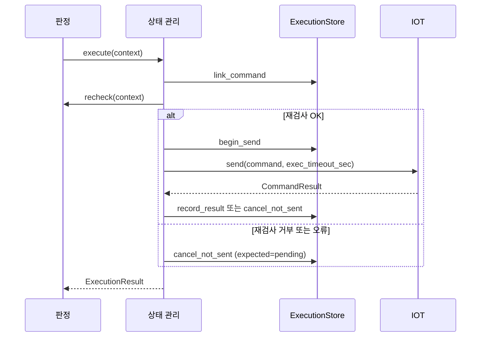

# 실행 인계와 명령 결과 정산

- 담당: JM-220 (상태 관리)
- 요구사항: FR-06, FR-07, FR-18, FR-19, NFR-03, NFR-04
- 따르는 결정: #15, #16, #17, #19, #35, #38, #78, #79, #80, #81, #82, #86, 2026-10-27 결정 3 (재조작과 반납의 경합)

## 1. 왜

- 판정은 허가와 예약을 마친 요청을 `ExecutionService.execute(context)`로 상태 관리에 넘긴다 (architecture.md §4 "실행 인계와 재검사").
- 저장소에는 실행 인계 접점의 구현이 없다. 반납·복구 건·공용 조명·복원은 내부 접점을 제공한다.
- 구현이 없으면 아래 문제가 생긴다.
  - 허가한 요청을 기기에서 실행할 수 없다 (FR-06).
  - 재검사 없이 명령을 보낼 수 있다 (FR-18).
  - 결과가 불명인 명령의 승인 사용분과 점유를 잘못 반환할 수 있다 (FR-19).
  - 같은 요청을 두 번 인계하면 기기가 두 번 동작할 수 있다 (NFR-03).

## 2. 무엇

이 spec은 실행 인계, 확실한 미전송 취소, 실행 중단 사유 전달과 결과 저장을 맡는다.
서버 내부 요청(공용 조명의 이탈 꺼짐)도 같은 실행 경로로 처리한다 (#86).

- 입력:
  - 판정의 `ExecutionContext`. 예약 시각 `reserved_at`을 담는다 (#80).
  - 상태 관리가 만든 서버 내부 요청의 `ExecutionContext` (`execution_kind=server_internal`)
  - 기기 결과 보고 `NodeResult`. 결과 대기 중의 보고와 결과 대기가 끝난 뒤의 보고다.
- 출력: `ExecutionResult`. 진행 상태는 `ExecutionStatus`다. 재검사가 전송을 막았으면 그 `Decision`을 담는다. 재검사 밖의 이유로 막았으면 `reason`에 중단 사유를 담는다 (#79).
- 바뀌는 상태 (모두 `ExecutionStore`로 반영한다):
  - 서버 내부 요청의 저장 (`link_internal_request`)
  - 명령 연결과 전송 시작 기록
  - 확실한 미전송이면 이번 요청의 예약과 승인 사용분 취소. 사유는 원인별로 구분한다 (#78)
  - 실행 성공이면 최초 대여의 기기와 점유 세션 `ACTIVE`, `rental_due_at`, 사용분 소진
  - 실행 실패나 불명이면 기기 `FAULT`, 사용분 보류, 점유 세션 보존
  - 검증된 `DEVICE_BUSY` 거부이면 이번 요청의 사용분 반환. 최초 대여이면 이번 예약 취소
- 약속:
  - 실행 직전 재검사가 `OK`일 때만 전송을 시작한다.
  - 같은 내부 요청은 동시에 인계해도 전송을 한 번만 시작한다.
  - 미전송이 확실할 때만 예약과 승인 사용분을 반환한다.
  - 실행 성공과 저장 반영을 확인한 뒤에만 `SUCCEEDED`와 `use_id`를 반환한다.
  - 업무 결과를 예외로 알리지 않는다.
  - 서버 내부 요청에는 판정의 재검사를 적용하지 않는다. 전송 직전에 유지 대상자, 복원 상태, 현재 연결을 확인한다.

## 3. 제약

- 전송 직전에 `DecisionRechecker.recheck(context)`를 부른다. `OK` 외 판정과 `recheck()`의 예외는 모두 전송을 막는다 (architecture.md §4 "실행 인계와 재검사").
- `recheck()`의 예외는 `DENY`와 `RECHECK_FAILED`의 검사 오류와 같게 다룬다 (§4 "실행 인계와 재검사").
- 재검사가 전송을 막으면 `cancel_not_sent(expected=PENDING)`로 이번 요청을 정리한다. 사유는 재검사의 사유, 검사 오류는 `RECHECK_FAILED`다 (§4 "예약 이후 저장").
- 재검사 밖의 이유로 전송을 막으면 `ExecutionResult.reason`에 아래 사유를 담는다. `reason`은 `recheck`가 없을 때만 쓴다 (§4 "실행 인계와 재검사", #79).

| 중단 원인 | `reason` | 저장 |
|---|---|---|
| `begin_send()`의 `COMMAND_IN_PROGRESS` | `COMMAND_IN_PROGRESS` | 방문자 요청은 `pending`을 유지한다. 서버 내부 요청은 `cancel_not_sent(expected=PENDING)` |
| `begin_send()`의 `STATE_CONFLICT` | `DEVICE_BUSY` | 위와 같다 |
| 재조작할 대여가 연결 전에 반납으로 닫혔다 (`link_command()`의 `STATE_CONFLICT`) | `USE_NOT_FOUND` | DB가 연결 거부와 함께 사용분을 반환한다. 다시 연결하지 않는다 |
| 재시작 복원 미완료 (`can_execute()`가 `False`) | `TARGET_UNAVAILABLE` | 방문자 요청은 `pending`을 유지한다. 서버 내부 요청은 명령 연결 뒤이면 취소한다 |
| 기기의 현재 연결 ID 없음 | `NODE_NOT_CONNECTED` | `cancel_not_sent(expected=PENDING, NODE_NOT_CONNECTED)` |
| 예약 대기 제한 만료 | `RESERVATION_EXPIRED` | `cancel_not_sent(expected=PENDING, RESERVATION_EXPIRED)` |
| IOT의 미전송 증명 | `COMMAND_NOT_SENT` | `cancel_not_sent(expected=IN_PROGRESS, COMMAND_NOT_SENT)` |

- `pending`을 유지한 방문자 요청은 예약 대기 제한이 지나면 `tick()`이 `RESERVATION_EXPIRED`로 취소한다.
- 정상 운영 중 예약 대기 만료도 이 spec이 처리한다. 재시작 때의 만료 처리는 `core-restore`가 맡는다 (FR-19).
- 예약 대기는 `ExecutionContext.reserved_at`부터 잰다. 실행 인계나 재검사 시각부터 다시 세지 않는다 (FR-19, #80).
- `reserved_at`이 `None`인 요청은 DB 쓰기가 없는 공용형(`usage_id`가 없는 공용형)과 서버 내부 요청뿐이다. 두 경우에는 예약 대기 제한을 적용하지 않는다. 그 밖의 요청에 `reserved_at`이 없거나 미래 시각이면 전송을 막고 `pending`을 유지한다.
- 예약 대기 제한을 넘긴 확실한 미전송 요청은 `cancel_not_sent(expected=PENDING)`로 취소한다. 전송 직전에도 기한을 확인한다 (FR-19).
- 만료 취소와 `begin_send()`가 경합하면 DB의 조건부 저장 결과를 따른다. 취소가 충돌하면 사용분을 임의로 반환하지 않는다 (architecture.md §4 "예약 이후 저장").
- `begin_send()`가 `APPLIED`일 때만 `NodeCommandGateway.send()`를 부른다. `ALREADY_APPLIED`는 재전송 허가가 아니다 (§4 "예약 이후 저장").
- `begin_send()`가 `CONFLICT`와 `COMMAND_IN_PROGRESS`이면 새 명령을 시작하지 않는다. 판정은 `BUSY`와 `COMMAND_IN_PROGRESS`로 응답한다 (§4 "실행·복원·복구의 공동 모델").
- `begin_send()`가 `CONFLICT`와 `STATE_CONFLICT`이면 전송하지 않는다. 기기가 `CLOSING` 또는 `FAULT`인 경우다 (FR-19 본인 재조작).
- 명령의 `target_session_id`는 `Repository.nodes()`가 반환한 `NodeInfo.session_id`다 (architecture.md §4 "기기 발표와 관측의 저장").
- 명령의 `expires_at`은 `issued_at`에 `exec_timeout_sec`를 더한 값이다. 결과 대기 시간도 `exec_timeout_sec`다. 두 값은 `context.settings`에서 받는다 (§5 MQTT 6절).
- 결과에 따라 아래 저장 함수를 부른다 (§4 "예약 이후 저장", "구동 중 추가 명령 제한의 저장").

| `CommandOutcome` | 저장 함수 | `ExecutionStatus` |
|---|---|---|
| `NOT_SENT` | `cancel_not_sent(expected=IN_PROGRESS, COMMAND_NOT_SENT)` | `not_sent` |
| `SUCCEEDED` | `record_result` | `succeeded` |
| `FAILED` | `record_result` | `failed` |
| `UNKNOWN` | `record_result` | `unknown` |
| `REJECTED` | `record_result` | `rejected` |

- 최초 대여의 성공에만 `rental_due_at`을 넘긴다. `rental_due_at`은 성공 시각에 `context.settings.rental_duration_sec`를 더한 값이다. 재조작과 공용형은 `None`을 넘긴다 (§4 "예약 이후 저장").
- 시간 초과를 `DEVICE_BUSY`로 추정하지 않는다. 시간 초과는 `UNKNOWN`이다 (§4 "구동 중 추가 명령 제한의 저장").
- `FAILED`와 `UNKNOWN`을 저장한 뒤 새 복구 건을 만든다. 복구 건 생성은 `core-fault-recovery`의 함수를 쓴다 (architecture.md §4 "복구 건과 복구 정산").
- 새 명령 ID로 자동 재시도하지 않는다 (FR-06, FR-19).
- `StoreOutcomeUnknown`이면 `execution(internal_request_id)`로 다시 조회한다. 저장을 확인하기 전에는 `SUCCEEDED`를 반환하지 않는다 (§4 "예약 이후 저장").
- 조회 결과가 없다는 이유만으로 미반영을 단정하지 않는다 (§4 "예약 이후 저장").
- 늦은 결과는 `record_result`로 넘긴다. 늦은 성공으로 `FAULT`를 해제하거나 종료한 점유 세션을 되살리지 않는다. 판단은 DB의 조건부 저장을 따른다 (FR-07).
- 같은 기기의 다른 구동 명령이 결과를 확정하지 못했으면 새 명령을 시작하지 않는다. 검사는 `begin_send()`가 원자적으로 한다 (FR-19).
- 재시작 복원과 확인을 끝내지 않은 기기에는 전송을 시작하지 않는다 (FR-19 재시작 복원). 복원 상태는 `core-restore`의 `ExecutionReadiness.can_execute`로 확인한다 (#82).
- 서버 내부 요청 (architecture.md §4 "서버 내부 요청", #86):
  - 판정의 `recheck()`를 부르지 않는다. 판정 기록이 없다.
  - 명령을 연결하기 전에 주입받은 내부 확인(공용 조명의 `can_request_off`), `can_execute()`, 현재 연결을 확인한다. 하나라도 실패하면 아무것도 저장하지 않고 `not_sent`를 반환한다.
  - 확인을 통과하면 같은 기기 잠금 안에서 `link_internal_request` → `link_command` → `begin_send`를 잇는다. 유지 대상자 변경은 같은 잠금으로 직렬화하므로 확인과 전송 시작 사이에 바뀌지 않는다.
  - 명령 연결 뒤 전송을 막으면 위 표의 사유로 `cancel_not_sent(expected=PENDING)`를 부른다. 내부 요청은 예약 대기 제한으로 정리되지 않기 때문이다.
  - 성공해도 `use_id`를 반환하지 않는다. `rental_due_at`은 `None`이다.
- `ExecutionResult`에 사용자 ID와 점유 주체를 넣지 않는다 (NFR-08).
- `lifecycle`은 다른 계층에 `shared/interfaces.py`의 Protocol로만 의존한다 (AGENTS.md 의존 규칙 4).

## 4. 경계

### 고치는 곳
- `server/src/nearpilot/core/lifecycle/`
- `server/tests/core/lifecycle/`

### 고치지 않는 곳
- 항상: `docs/`, `AGENTS.md` (Gotchas 절은 제외), `server/src/nearpilot/shared/`, `server/pyproject.toml`, `.github/`
- 이 작업: `core/decision/`, `core/proximity/`, `core/policy/`, `core/allocation/`, `db/`, `api/`, `iot/`

### 다른 영역과 닿는 곳
| 계약 | 사용 또는 제공 | 상대 영역 |
|---|---|---|
| `ExecutionService.execute` | 제공 | 판정 |
| `DecisionRechecker.recheck` | 사용 | 판정 |
| `ExecutionStore.link_internal_request`, `link_command`, `begin_send`, `cancel_not_sent`, `record_result`, `execution` | 사용 | DB |
| `ExecutionReadiness.can_execute` | 사용 (`core-restore`가 제공) | 상태 관리 |
| 내부 꺼짐 확인 (`SharedLightService.can_request_off`) | 사용 | 상태 관리 |
| `Repository.nodes` | 사용 (`target_session_id` 조회) | DB |
| `NodeCommandGateway.send` | 사용 | IOT |
| `NodeEventSink.on_result` | 제공 (`core-node-events`가 이 spec의 정산 함수로 넘긴다) | IOT |

### 만들지 않는 것
- 판정과 호스트 응답 변환 (판정, FR-09)
- 실행 직전 재검사의 내용 (판정)
- 반납과 종료 (`core-release`)
- 복구 건의 내용과 복구 정산 (`core-fault-recovery`)
- 재시작 복원 (`core-restore`)
- 공용 조명의 유지 대상자 (`core-shared-light`)

## 5. 예외 상황

| 상황 | 기대 동작 | 테스트 |
|---|---|---|
| 같은 `internal_request_id`를 다시 인계한다 | 기존 진행 상태나 결과를 반환한다. 새 명령을 만들지 않는다 | `test_FR18_duplicate_handover_returns_existing` |
| 같은 `internal_request_id`를 두 스레드가 동시에 인계한다 | `send()`를 한 번만 부른다 | `test_NFR03_concurrent_handover_sends_once` |
| 재검사가 `ASK`를 반환한다 | 전송하지 않는다. `cancel_not_sent(expected=PENDING)`를 부른다. `recheck`에 그 판정을 담는다 | `test_FR18_recheck_reject_blocks_send` |
| `recheck()`가 예외를 던진다 | 전송하지 않는다. `RECHECK_FAILED`로 정리한다 | `test_FR18_recheck_exception_blocks_send` |
| 인계 시점에 이미 예약 대기 제한이 지났다 | 전송하지 않는다. `RESERVATION_EXPIRED`로 취소하고 `reason`에 담는다 | `test_FR19_expired_reservation_cancelled_with_reason` |
| 정상 운영 중 `pending`으로 남은 예약의 대기 제한이 지난다 | `tick()`이 예약 시각 기준으로 만료 취소한다. 재시작을 기다리지 않는다 | `test_FR19_live_pending_expires` |
| 재검사 중 예약 대기 제한이 지난다 | 전송하지 않고 `RESERVATION_EXPIRED`로 조건부 취소한다 | `test_FR19_expiry_during_recheck_blocks_send` |
| 만료 취소와 전송 시작이 경합한다 | DB에서 성공한 상태 전이만 따른다. 취소가 `CONFLICT`이면 저장한 상태를 따르고 사용분을 임의로 반환하지 않는다 | `test_FR19_expiry_races_begin_send` |
| `reserved_at`이 없거나 미래 시각이다 | 전송하지 않는다. `pending`을 유지한다 | `test_FR19_missing_or_future_reservation_blocks_send` |
| DB 쓰기가 없는 공용형 요청이다 (`reserved_at` 없음) | 예약 대기 제한 없이 실행한다 | `test_FR19_shared_without_reservation_executes` |
| 다른 명령이 같은 기기에서 진행 중이다 | `begin_send()`가 `COMMAND_IN_PROGRESS`다. 전송하지 않는다. `reason`은 `COMMAND_IN_PROGRESS`다 | `test_FR19_begin_conflict_blocks_send` |
| 반납이 시작되어 기기가 `CLOSING`이다 | `begin_send()`가 `STATE_CONFLICT`다. 전송하지 않는다. `reason`은 `DEVICE_BUSY`다 | `test_FR19_begin_conflict_blocks_send` |
| 재시작 복원을 마치지 않은 기기다 | 전송하지 않는다. `pending`을 유지하고 `reason`은 `TARGET_UNAVAILABLE`이다 | `test_FR19_restore_unconfirmed_blocks_send` |
| 재조작 인계 전에 같은 사용자의 반납이 대여를 닫았다 | `link_command()`가 `CONFLICT`와 `NOT_SENT` 명령을 돌려준다. 전송하지 않는다. 결과는 `NOT_SENT`이고 `reason`은 `USE_NOT_FOUND`다. 예외를 내지 않는다. 재인계(재시작 뒤 포함)가 그 명령을 `ALREADY_APPLIED`로 받아도 같은 결과다 | `test_FR19_reoperation_link_after_close_is_use_not_found` |
| 그 밖의 연결 충돌이다 (최초 대여·공용형의 `STATE_CONFLICT`, 재조작의 `CONTENT_CONFLICT`) | 지금처럼 `link_conflict`로 막는다. 사유를 정하지 않는다 | `test_FR19_other_link_conflicts_stay_link_conflict` |
| 기기의 현재 연결 ID가 없다 | 전송하지 않는다. `NODE_NOT_CONNECTED`로 취소하고 `reason`에 담는다 | `test_FR06_no_session_cancelled_with_reason` |
| IOT가 `NOT_SENT`를 반환한다 | `cancel_not_sent(expected=IN_PROGRESS, COMMAND_NOT_SENT)`를 부른다. `reason`은 `COMMAND_NOT_SENT`다 | `test_FR19_iot_not_sent_cancelled_with_reason` |
| 서버 내부 요청을 인계한다 | 재검사 없이 내부 확인 뒤 `link_internal_request`로 저장하고 전송한다 | `test_FR20_internal_request_executes_without_recheck` |
| 서버 내부 요청의 내부 확인이 실패한다 | 아무것도 저장하지 않고 전송하지 않는다 | `test_FR20_internal_request_check_failure_stores_nothing` |
| 서버 내부 요청의 전송 시작이 충돌한다 | 사유와 함께 `cancel_not_sent(expected=PENDING)`로 정리한다 | `test_FR20_internal_request_begin_conflict_cancels` |
| IOT가 `UNKNOWN`을 반환한다 | `record_result(UNKNOWN)`을 부른다. 사용분을 반환하지 않는다. 복구 건을 만든다 | `test_NFR04_failed_or_unknown_creates_recovery_and_holds_usage` |
| IOT가 `FAILED`를 반환한다 | `record_result(FAILED)`을 부른다. 복구 건을 만든다 | `test_NFR04_failed_or_unknown_creates_recovery_and_holds_usage` |
| IOT가 `REJECTED`를 반환한다 | `record_result(REJECTED)`을 부른다. 복구 건을 만들지 않는다 | `test_FR19_device_busy_rejected_not_fault` |
| 재조작이 `REJECTED`다 | 기존 점유와 `rental_due_at`을 보존한다. `rental_due_at`을 넘기지 않는다 | `test_FR19_reoperation_reject_keeps_existing_due` |
| 재조작이 성공한다 | `rental_due_at`에 `None`을 넘긴다 | `test_FR19_reoperation_and_shared_success_keep_due` |
| `record_result`가 `StoreOutcomeUnknown`을 던진다 | `execution()`으로 다시 조회한다. 확인 전에는 `SUCCEEDED`를 반환하지 않는다 | `test_FR19_store_unknown_requeries_before_success` |
| 결과 대기가 끝난 뒤 성공 결과가 온다 | `record_result`로 넘긴다. DB가 `CONFLICT`를 반환하면 `FAULT`를 유지한다 | `test_FR07_late_success_keeps_fault` |
| 같은 결과 사건이 `send()` 반환과 `on_result()`로 두 번 온다 | 완료한 사건은 중복 저장하지 않는다. 저장 재시도는 `ALREADY_APPLIED`를 따른다 | `test_FR07_same_event_settled_once` |

## 6. 결정

- `execution.py`에 `ExecutionService`를 둔다 — 담당자가 2026-10-15에 추천 구성을 선택했다.
- 시계·공통 기기 재진입 잠금·복원 확인·복구 건 생성을 주입한다 — 반납·복원·복구와 같은 잠금을 쓴다.
- 최초 대여시간은 서버가 결과를 처음 확정한 시각부터 잰다 — 기기 사건 시각은 별도로 보존한다. 저장 재시도는 같은 기준을 쓴다.
- 외부 `tick()`으로 결과 저장과 취소 저장을 재시도한다 — 자체 스레드와 새 시간 설정을 만들지 않는다.
- `execute()`는 저장 오류에도 확인한 진행 상태를 반환한다 — 저장 확인 전에는 성공과 `use_id`를 반환하지 않는다.
- `on_result(context, report)`는 검증한 보고의 내부 인계다 — 사건 연결을 검사하고 저장 실패는 예외로 알린다. 실제 이벤트 조립은 후속 작업이다.
- 전송 시작의 반영이 불명이면 조회만 한다 — 조회로 시작 기록을 확인해도 명령을 보내지 않는다.
- 저장할 결과와 취소 근거를 메모리에 보존한다 — 같은 사건의 재시도에서 시각과 내용을 바꾸지 않는다.
- 저장 뒤 확인 조회까지 실패해도 복구 건 생성을 재시도한다 — 같은 실패·불명 사건의 `ALREADY_APPLIED`는 복구 건 저장을 대신하지 않는다.
- 통신 대기 중에는 기기 잠금을 푼다 — 다른 스레드의 결과 인계가 끝나야 통신 대기를 끝내는 경우에도 교착하지 않는다.
- `blockers(internal_request_id)`로 내부 보류 이유를 읽는다 — 공동 응답 모델에 임시 사유를 추가하지 않는다.
- 방문자 요청의 `begin_send` 충돌과 복원 미완료는 즉시 취소하지 않는다 — 공동 계약의 취소 사유에 없는 원인이다. 예약 대기 제한이 지나면 `tick()`이 `RESERVATION_EXPIRED`로 취소한다.
- 서버 내부 요청의 확인을 명령 연결 전에 한다 — 확인 실패 때 정리할 저장 기록을 만들지 않는다. 내부 확인 함수는 `confirm_internal`로 주입한다.
- 서버 내부 요청의 명령 연결 뒤 차단은 §4 표의 사유로 즉시 취소한다 — 예약 시각이 없어 만료 취소가 일어나지 않는다.

## 7. 가정

- #78 A안: 취소 사유는 예약 대기 제한 `RESERVATION_EXPIRED`, 현재 연결 없음 `NODE_NOT_CONNECTED`, IOT 미전송 증명 `COMMAND_NOT_SENT`다.
- #79 A안: 재검사 밖의 이유로 전송을 막으면 `ExecutionResult.reason`에 사유를 담는다.
- #80 B안: 판정이 `ReserveResult.reserved_at`을 `ExecutionContext.reserved_at`으로 넘긴다. 이 spec은 문맥의 값을 쓴다.
- 인계 전에 오류로 끝난 예약의 정리는 architecture.md §4의 미결(판정·DB 담당)이다. 이 spec은 인계받은 요청만 만료 취소한다.
- #86 A안: 서버 내부 요청은 `InternalRequest`로 저장하고 기존 실행 경로를 쓴다. 내부 요청을 만드는 쪽은 `core-shared-light`다.
- `NodeResult`의 검증은 IOT가 맡는다. 이 서비스는 요청·명령·기기 연결과 완료 상태를 추가로 확인한다.
- 재시작 뒤 늦은 결과의 인계에는 원래 `ExecutionContext`가 필요하다. `ExecutionStore.execution_context`(#83)와 서버 조립의 연결은 `core-node-events`와 서버 조립 작업이다.
- 서버 조립과 실제 MQTT 연결은 이 spec에 넣지 않는다.

## 8. 테스트

| 요구사항 | 테스트 | 확인하는 것 |
|---|---|---|
| FR-06 | `test_FR06_execute_sends_command_after_recheck` | 재검사 `OK` 뒤에만 `send()`를 부른다. 명령에 현재 연결 ID와 만료 시각을 담는다 |
| FR-07 | `test_FR07_gateway_exception_is_unknown_not_not_sent` | 시간 초과와 통신 오류를 미전송으로 바꾸지 않는다 |
| FR-18 | `test_FR18_recheck_reject_blocks_send` | 재검사 거부의 판정과 사유를 보존하고 조건부 취소한다 |
| FR-19 | `test_FR19_initial_success_sets_rental_due_at` | 최초 대여 성공에 성공 시각과 `rental_duration_sec`로 계산한 `rental_due_at`을 넘긴다 |
| NFR-03 | `test_NFR03_concurrent_handover_sends_once` | 동시 인계에도 물리 명령은 한 번이다 |
| NFR-04 | `test_NFR04_failed_or_unknown_creates_recovery_and_holds_usage` | 실패·불명 뒤 복구 건을 만들고 사용분을 보존한다 |
| FR-06 | `test_FR06_begin_unknown_never_authorizes_send` | 불명 시작 기록을 조회해도 재전송하지 않는다 |
| FR-19 | `test_FR19_store_unknown_requeries_before_success` | 저장 불명은 조회한다. 확인 전에는 성공과 `use_id`를 반환하지 않는다 |
| FR-19 | `test_FR19_result_not_applied_retry_keeps_original_due` | 저장 재시도는 원래 결과 시각과 대여시간 기준을 쓴다 |
| FR-19 | `test_FR19_execution_uses_real_restore_gate` | 실제 복원 서비스의 현재 연결 확인 뒤 전송한다 |
| FR-19 | `test_FR19_expiry_during_recheck_blocks_send` | 재검사 중 예약 대기가 만료하면 `RESERVATION_EXPIRED`로 취소한다 |
| FR-19 | `test_FR19_live_pending_expires` | `pending`으로 남은 예약을 `tick()`이 예약 시각 기준으로 취소한다 |
| FR-19 | `test_FR19_expiry_races_begin_send` | 만료 취소의 `CONFLICT`에서 사용분을 임의로 반환하지 않는다 |
| FR-06 | `test_FR06_no_session_cancelled_with_reason` | 현재 연결이 없으면 `NODE_NOT_CONNECTED`로 취소하고 사유를 반환한다 |
| FR-19 | `test_FR19_iot_not_sent_cancelled_with_reason` | IOT 미전송 증명을 `COMMAND_NOT_SENT`로 취소한다 |
| FR-19 | `test_FR19_begin_conflict_blocks_send` | 구동 경합과 상태 충돌의 사유를 `reason`으로 반환한다 |
| FR-19 | `test_FR19_reoperation_link_after_close_is_use_not_found` | 반납과 겹친 재조작은 `USE_NOT_FOUND`로 끝난다 |
| FR-19 | `test_FR19_other_link_conflicts_stay_link_conflict` | 반납 경합이 아닌 연결 충돌은 바뀌지 않는다 |
| FR-20 | `test_FR20_internal_request_executes_without_recheck` | 서버 내부 요청을 재검사 없이 저장하고 전송한다 |
| FR-07 | `test_FR07_late_success_keeps_fault` | 늦은 성공을 저장에 넘긴다. 기존 격리와 사용분 보류를 유지한다 |
| FR-07 | `test_FR07_restart_same_event_does_not_recalculate_rental_due` | 재시작 뒤 같은 보고로 대여시간 기준을 다시 계산하지 않는다 |
| NFR-03 | `test_NFR03_report_can_arrive_during_gateway_wait_without_deadlock` | 통신 대기 중 다른 스레드의 결과를 받는다 |
| NFR-04 | `test_NFR04_result_committed_but_query_failed_still_creates_recovery` | 결과 저장 뒤 조회가 실패해도 복구 건을 보완한다 |

- `ExecutionStore`, `DecisionRechecker`, `NodeCommandGateway`, `Repository`는 fake로 대신한다.
- 전체 서버 조립과 실제 MQTT 연결은 이번 구현에 넣지 않는다.
