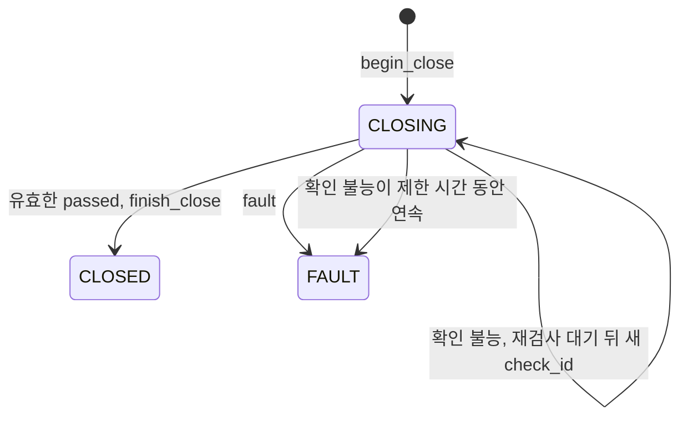

# 대여형 명시적 반납과 반납 검사

- 상태: 구현 중. 반납 서비스의 단위 검증을 마쳤다. 후속 spec의 실제 연결이 남았다.
- 담당: JM-220 (상태 관리)
- 요구사항: FR-07, FR-19, FR-20, FR-21, NFR-04
- 따르는 결정: #15, #17, #19, #37

## 1. 왜

- 방문자는 `release_use`로 본인 대여를 끝낸다 (FR-09).
- 서버는 소유권과 안전을 확인한 뒤에만 점유를 해제해야 한다 (product.md 원칙, FR-20).
- 저장소에는 반납 흐름의 구현이 없다.
- 구현이 없으면 아래 문제가 생긴다.
  - 문이 열린 사물함을 다음 방문자에게 허가할 수 있다.
  - 오래된 검사 결과나 다른 반납의 검사 결과로 종료할 수 있다.
  - 반납 검사가 계속 실패해도 기기를 격리하지 못한다.

## 2. 무엇

- 입력:
  - 반납 요청: 토큰 계정의 `user_id`, `use_id`
  - 반납 검사 결과 `SafetyCheckResult`
  - 반납 완료 기록 조회: `use_id`
- 출력:
  - 반납 요청의 `Decision`. 사용자 ID와 점유 주체를 담지 않는다.
  - 반납 상태 조회 값: 점유 세션 상태, 대여시간 기준 시각, 초과시간, 종료 시각
- 바뀌는 상태:
  - 기기와 점유 세션 `CLOSING` (`begin_close`)
  - 종료하면 세션 `CLOSED`, 기기 `AVAILABLE`, `closed_at`, 채택한 `check_id`와 근거 (`finish_close`)
  - `fault` 결과이거나 확인 불능이 제한 시간 동안 이어지면 기기 `FAULT`와 새 복구 건
  - 상태 관리 메모리의 반납별 현재 `check_id`, 확인 불능 시작 시각, 재검사 타이머
- 약속:
  - 본인 점유 세션만 반납한다.
  - 이번 반납의 현재 유효한 `passed` 결과로만 종료한다.
  - 문이 열린 정상 대기에는 자동 종료 시간을 두지 않는다.
  - 종료 저장의 완료를 확인한 뒤에만 반납 완료를 안내한다.

## 3. 제약

- 반납 요청마다 `session_owner_matches(use_id, user_id)`로 소유권을 대조한다. 없는 핸들과 타인 핸들은 같은 `USE_NOT_FOUND`다 (FR-21, NFR-07).
- 대여시간 초과는 반납을 막지 않는다 (FR-20, FR-21).
- `begin_close(use_id, EndReason.RELEASE)`로 `CLOSING`을 시작한다. `COMMAND_IN_PROGRESS` 충돌이면 반납 시작을 보류한다 (FR-19).
- 검사 기준은 `UseSession.check_criteria`다. 검사 기준이 없으면 검사 통과로 추정하지 않는다 (FR-20).
- 검사 요청마다 새 `check_id`를 만든다. 새 `check_id`를 만들면 이전 검사를 무효로 한다 (architecture.md §4 "반납 검사와 종료").
- 검사 요청은 `SafetyCheckGateway.request_check()`로 보낸다. 대상 연결은 `NodeInfo.session_id`다. `expires_at`은 `issued_at`에 `safety_check_timeout_sec`를 더한 값이다 (§5 MQTT 3절).
- 검사 결과를 아래 조건을 모두 만족할 때만 유효로 본다 (architecture.md §4 "반납 검사와 종료").
  - `check_id`가 이번 반납의 현재 검사다.
  - 결과가 응답 기한 안에 왔다.
  - 기기 연결 ID가 검사를 요청한 연결과 같다.
  - 검사 기준의 ID와 버전이 요청과 같다.
  - 검사 시각의 나이가 `safety_report_max_age_sec` 이하다.
- 결과별 처리는 아래 표를 따른다 (FR-20).

| 결과 | 처리 |
|---|---|
| 유효한 `passed` | 종료 가능 상태를 다시 검사한다. `finish_close`로 종료를 저장한다. 확인 불능 타이머를 해제한다 |
| 유효한 `not_ready` | `CLOSING`을 유지한다. 확인 불능 타이머를 해제한다. `safety_check_retry_sec` 뒤 새 검사를 요청한다 |
| 유효한 `fault` | `isolate_device`로 즉시 격리한다. 점유를 보존한다. 새 복구 건을 만든다 |
| `unknown`, 유효하지 않은 결과, 응답 기한 초과, 전송 실패 | 확인 불능이다. 타이머가 없으면 시작한다. `safety_check_retry_sec` 뒤 새 검사를 요청한다 |

- 확인 불능이 `safety_unconfirmed_limit_sec` 동안 연속으로 이어지면 기기를 격리하고 점유를 보존한다 (FR-20).
- 새 검사 발급과 오래된 보고 수신은 확인 불능 타이머를 초기화하지 않는다 (FR-20).
- 기기 재접속과 새 장애는 진행 중인 검사를 무효로 한다 (architecture.md §4 "반납 검사와 종료").
- 이미 `CLOSING`인 반납은 비콘을 다시 받아도 `ACTIVE`로 되돌리지 않는다 (FR-20).
- 기기가 `FAULT`가 되면 반납 검사 요청을 멈춘다. 이후는 복구 규칙을 따른다 (NFR-04).
- `finish_close`가 `StoreOutcomeUnknown`이면 `close_result(use_id)`로 확인한다. 현재 `AVAILABLE` 여부로 저장 성공을 추정하지 않는다 (FR-20).
- 초과시간은 저장하지 않고 계산한다. 종료 전에는 현재 시각, 종료 뒤에는 `closed_at`을 쓴다. 초과 전에는 0이다 (FR-19).
- 모든 시간 값은 `Settings`에서 받는다. 반납 시작 때의 설정 하나를 그 반납 전체에 적용한다 (requirements.md §1.2).
- 응답에 사용자 ID와 점유 주체를 넣지 않는다 (FR-11, NFR-08).

## 4. 경계

### 고치는 곳
- `server/src/nearpilot/core/lifecycle/`
- `server/tests/core/lifecycle/`

### 고치지 않는 곳
- 항상: `docs/`, `AGENTS.md` (Gotchas 절은 제외), `server/src/nearpilot/shared/`, `server/pyproject.toml`, `.github/`
- 이 작업: `core/decision/`, `core/proximity/`, `core/policy/`, `core/allocation/`, `db/`, `api/`, `iot/`

### 다른 영역과 닿는 곳
| 계약 | 사용 또는 제공 | 상대 영역 |
|---|---|---|
| `Repository.session`, `session_owner_matches`, `nodes` | 사용 | DB |
| `ExecutionStore.begin_close`, `finish_close`, `close_result`, `isolate_device` | 사용 | DB |
| `SafetyCheckGateway.request_check` | 사용 | IOT |
| `NodeEventSink.on_safety_check_result` | 제공 (`core-node-events`가 이 spec으로 넘긴다) | IOT |
| `CoreService.release_use`와 같은 시그니처의 반납 함수 | 제공 | 판정 (MCP 도구) |

### 만들지 않는 것
- MCP 도구 `release_use`, `get_use_status`의 응답 변환 (판정)
- 공용 조명의 꺼짐 (`core-shared-light`)
- 복구 건의 내용과 복구 정산 (`core-fault-recovery`)
- 재시작 뒤 반납의 재개 (`core-restore`). 이 spec은 재개에 쓸 함수를 제공한다.

## 5. 예외 상황

| 상황 | 기대 동작 | 테스트 |
|---|---|---|
| 타인의 `use_id`로 반납한다 | `DENY`와 `USE_NOT_FOUND`다. 상태를 바꾸지 않는다 | `test_FR21_release_other_users_handle_denied` |
| 대여시간을 넘긴 세션을 반납한다 | 반납을 시작한다 | `test_FR20_overdue_release_allowed` |
| 다른 구동 명령이 진행 중이다 | `begin_close`가 `COMMAND_IN_PROGRESS`다. `BUSY`와 `COMMAND_IN_PROGRESS`를 반환한다 | `test_FR19_release_blocked_by_command` |
| 이미 `CLOSING`인 세션을 다시 반납한다 | 새 `CLOSING`을 만들지 않는다. 진행 중인 반납 상태를 반환한다 | `test_FR20_repeat_release_idempotent` |
| 세션에 검사 기준이 없다 | 통과로 보지 않는다. 확인 불능으로 다룬다 | `test_FR20_missing_criteria_not_passed` |
| 이전 `check_id`의 `passed`가 늦게 온다 | 종료 근거로 쓰지 않는다 | `test_FR20_stale_check_id_ignored` |
| 검사 시각이 `safety_report_max_age_sec`보다 오래됐다 | 유효하지 않은 결과로 다룬다 | `test_FR07_old_safety_report_invalid` |
| 다른 기기 연결 ID의 결과가 온다 | 유효하지 않은 결과로 다룬다 | `test_FR20_session_mismatch_invalid_and_criteria_mismatch_invalid` |
| 검사 기준 버전이 다르다 | 유효하지 않은 결과로 다룬다 | `test_FR20_session_mismatch_invalid_and_criteria_mismatch_invalid` |
| `not_ready`가 30분 동안 이어진다 | 격리하지 않는다. `CLOSING`을 유지한다 | `test_FR20_not_ready_no_timeout` |
| 응답 기한 초과가 `safety_unconfirmed_limit_sec` 동안 이어진다 | `isolate_device`를 부른다. 점유를 보존한다 | `test_FR20_unconfirmed_limit_isolates` |
| 확인 불능 중에 새 검사를 발급한다 | 확인 불능 타이머를 유지한다 | `test_FR20_new_check_keeps_timer` |
| `fault` 결과가 온다 | 즉시 격리한다 | `test_FR20_fault_isolates_immediately` |
| `finish_close`가 `StoreOutcomeUnknown`을 던진다 | `close_result`로 확인한다. `None`이면 완료를 안내하지 않는다 | `test_FR20_close_unknown_requeries` |
| 같은 반납과 같은 `check_id`로 `finish_close`를 다시 부른다 | `ALREADY_APPLIED`를 성공으로 본다 | `test_FR20_finish_close_retry_same_check` |

## 6. 결정

- 담당자는 `release.py`에 반납 서비스를 두기로 정했다.
- 담당자는 시계와 기기별 공통 잠금을 주입하기로 정했다. 기기 이벤트와 복구도 같은 잠금을 사용한다.
- 담당자는 외부 호출자가 `tick()`으로 응답 기한, 재검사, 확인 불능 제한을 검사하기로 정했다. 서비스는 자체 스레드를 만들지 않는다.
- 반납 서비스는 `release_use`, `get_use_status`, `on_safety_check_result`, `resume_close`, `tick`을 제공한다.
- 진행 중인 반납은 `BUSY`와 `OK`, 검사 중 안내를 반환한다. 저장 완료를 확인한 반납만 `OK`와 완료 안내를 반환한다.
- 반납 요청에는 외부 요청 ID가 없다. `Decision.request_id`는 빈 문자열로 둔다. 본인 세션의 내부 요청 ID는 기존 값을 사용한다.
- 종료 저장 재시도는 채택한 검사, 근거와 최초 종료 시각을 유지한다. 저장이 불명이면 완료 기록을 먼저 조회한다.
- 새 장애 격리 뒤 복구 건 생성 함수를 반드시 호출한다. 생성 함수는 생성 실패 재시도에 같은 복구 ID를 유지해야 한다.
- 기존 spec은 구현 전에 `main`에 커밋했다. 이 브랜치는 구현과 담당자 결정을 한 커밋으로 기록한다.

## 7. 가정

- #90 A안으로 정했다: 검사 기준의 내용과 버전은 architecture.md §4 "반납 검사와 종료"의 개발 기준을 따른다 (FR-20). 이 spec은 `UseSession.check_criteria`의 ID와 버전만 비교한다.
- #90 A안으로 정했다: `evidence`의 필수 항목은 개발 기준을 따른다. 필수 항목 검사는 시뮬레이터와 후속 작업에서 반영한다. 이 spec은 받은 `evidence`를 그대로 `finish_close`에 넘긴다.
- 미결: 같은 `check_id`에 다른 내용이 온 충돌을 펌웨어가 보고하는 형식. 그때까지 응답 기한 초과로 다룬다 (architecture.md §4 "반납 검사와 종료").
- 미결 — #88: `CoreService` 조립 담당. 이 spec은 `release_use(user_id, use_id) -> Decision`과 같은 시그니처의 함수를 제공한다. 판정이 MCP 도구에 연결한다고 가정한다.
- 선행 연결: 복구 건 생성 함수는 `core-fault-recovery`가 제공한다. 이번 작업은 필수 주입 접점을 fake로 검증한다. 복구 건 저장의 실제 연결 완료로 보지 않는다.
- 선행 연결: `core-node-events`는 검사 결과를 전달한다. `core-restore`는 기기 확인 뒤 `resume_close()`를 호출한다. 서버 조립은 `tick()`을 반복 호출한다.
- 검사 기준 내용과 필수 근거가 정해져도 반납 서비스는 기준 ID·버전을 비교하고 받은 근거를 보존한다. 검사 기준의 물리 판정은 기기가 맡는다.

## 8. 테스트

| 요구사항 | 테스트 | 확인하는 것 |
|---|---|---|
| FR-07 | `test_FR07_status_report_not_close_evidence` | 일반 `status`와 실행 성공으로 종료하지 않는다 |
| FR-19 | `test_FR19_overtime_calculation` | 종료 전에는 현재 시각, 종료 뒤에는 `closed_at`으로 초과시간을 계산한다 |
| FR-20 | `test_FR20_passed_closes_session` | 유효한 `passed`로 `finish_close`에 `check_id`와 근거를 넘긴다 |
| FR-20 | `test_FR20_not_ready_retries_with_new_check_id` | `not_ready` 뒤 재검사 간격을 기다리고 새 `check_id`로 요청한다 |
| FR-21 | `test_FR21_release_checks_owner` | 반납마다 소유권을 대조한다 |
| NFR-04 | `test_NFR04_fault_keeps_session` | 격리해도 점유 세션을 보존한다 |

- 시간은 주입한 시계로 제어한다. `ExecutionStore`, `Repository`, `SafetyCheckGateway`는 fake로 대신한다.
