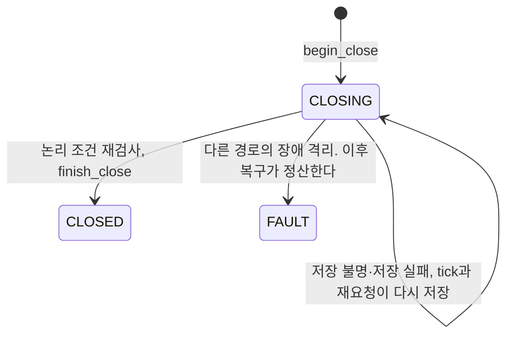

# 대여형 명시적 반납과 논리적 종료

- 담당: JM-220 (상태 관리)
- 요구사항: FR-19, FR-20, FR-21, NFR-04
- 따르는 결정: #15, #17, #19, #88, 2026-10-26 센서 기반 물리 검증 제외 (#196)

## 1. 왜

- 방문자는 `release_use`로 본인 대여를 끝낸다 (FR-09).
- 서버는 본인 점유, 미완료 명령과 장애 상태를 검사한 뒤 점유를 해제한다 (product.md 원칙, FR-20).
- 2026-10-26 결정으로 센서 기반 반납 검사를 제외했다. 반납 완료는 서버의 논리적 점유 해제다.
- 이전 구현은 기기의 반납 검사 결과를 기다렸다. 센서가 없으면 반납이 끝나지 않는다.

## 2. 무엇

- 입력:
  - 반납 요청: 토큰 계정의 `user_id`, `use_id`
  - 반납 완료 기록 조회: `use_id`
- 출력:
  - 반납 요청의 `Decision`. 사용자 ID와 점유 주체를 담지 않는다.
  - 반납 상태 조회 값: 점유 세션 상태, 대여시간 기준 시각, 초과시간, 종료 시각
- 바뀌는 상태:
  - 기기와 점유 세션 `CLOSING` (`begin_close`)
  - 종료하면 세션 `CLOSED`, 기기 `AVAILABLE`, `closed_at`, 종료 사유 `release` (`finish_close`)
  - 상태 관리 메모리: 저장 결과가 불명이거나 저장하지 못한 반납과 처음 정한 종료 시각
- 약속:
  - 본인 점유 세션만 반납한다.
  - 미완료 명령이나 `FAULT`가 있으면 점유를 해제하지 않는다.
  - 종료 저장의 완료를 확인한 뒤에만 반납 완료를 안내한다.
  - 반납 완료는 문 닫힘, 잠금과 물리 안전의 증명이 아니다.

## 3. 제약

- 반납 요청마다 `session_owner_matches(use_id, user_id)`로 소유권을 대조한다. 없는 핸들과 타인 핸들은 같은 `USE_NOT_FOUND`다 (FR-21, NFR-07).
- 대여시간 초과는 반납을 막지 않는다 (FR-20, FR-21).
- 기기가 `FAULT`이면 반납을 시작하지 않는다. `DENY`와 `TARGET_UNAVAILABLE`이다. 점유는 복구 절차가 정산한다 (NFR-04).
- `begin_close(use_id, EndReason.RELEASE)`로 `CLOSING`을 시작한다. `COMMAND_IN_PROGRESS` 충돌이면 `BUSY`와 `COMMAND_IN_PROGRESS`로 보류한다 (FR-19).
- `CLOSING`은 논리적 종료를 저장하는 상태다. 문 닫힘, 잠금이나 센서 응답을 기다리지 않는다 (FR-20).
- 종료 직전에 세션과 기기가 `CLOSING`인지 다시 확인한다. `finish_close(use_id, closed_at, EndReason.RELEASE)`는 같은 트랜잭션에서 상태와 미완료 구동 명령을 검사한다 (architecture.md §4 "명시적 반납과 논리적 종료").
- `finish_close`가 `COMMAND_IN_PROGRESS` 충돌이면 `BUSY`와 `COMMAND_IN_PROGRESS`다. 다른 충돌은 `TARGET_UNAVAILABLE`이다. 둘 다 점유를 보존한다.
- 종료 사유가 `release`가 아닌 `CLOSING` 세션은 이 서비스가 종료하지 않는다.
- `finish_close`가 `StoreOutcomeUnknown`이면 `close_result(use_id)`로 확인한다. 현재 `AVAILABLE` 여부로 저장 성공을 추정하지 않는다 (FR-20).
- 저장 재시도는 처음 정한 종료 시각을 유지한다. 같은 반납의 재요청에는 기존 완료 결과를 반환한다.
- `close_result`의 종료 사유가 `release`일 때만 반납 완료로 안내한다. 복구나 취소로 끝난 세션은 반납 완료가 아니다.
- 이미 `CLOSING`인 반납은 비콘을 다시 받아도 `ACTIVE`로 되돌리지 않는다 (FR-20).
- 반납 검사 요청, 검사 기준, 센서 근거와 검사 재시도 타이머를 쓰지 않는다 (FR-20).
- 초과시간은 저장하지 않고 계산한다. 종료 전에는 현재 시각, 종료 뒤에는 `closed_at`을 쓴다. 초과 전에는 0이다 (FR-19).
- 시간 값은 `Settings`에서 받는다 (requirements.md §1.2).
- 응답에 사용자 ID와 점유 주체를 넣지 않는다 (FR-11, NFR-08).

## 4. 경계

### 고치는 곳
- `server/src/nearpilot/core/lifecycle/`
- `server/tests/core/lifecycle/`

### 고치지 않는 곳
- 항상: `docs/`, `AGENTS.md` (Gotchas 절은 제외), `server/pyproject.toml`, `.github/`
- 이 작업: `core/decision/`, `core/proximity/`, `core/policy/`, `core/allocation/`, `api/`

### 다른 영역과 닿는 곳
| 계약 | 사용 또는 제공 | 상대 영역 |
|---|---|---|
| `Repository.session`, `session_owner_matches`, `nodes` | 사용 | DB |
| `ExecutionStore.begin_close`, `finish_close`, `close_result` | 사용 | DB |
| `CoreService.release_use`와 같은 시그니처의 반납 함수 | 제공 | 판정 (MCP 도구) |

### 만들지 않는 것
- MCP 도구 `release_use`, `get_use_status`의 응답 변환 (판정)
- 공용 조명의 꺼짐 (`core-shared-light`)
- 복구 건과 복구 정산 (`core-fault-recovery`)
- 재시작 뒤 반납의 재개 (`core-restore`). 이 spec은 재개에 쓸 함수를 제공한다.

## 5. 예외 상황

| 상황 | 기대 동작 | 테스트 |
|---|---|---|
| 타인의 `use_id`로 반납한다 | `DENY`와 `USE_NOT_FOUND`다. 상태를 바꾸지 않는다 | `test_FR21_release_other_users_handle_denied` |
| 대여시간을 넘긴 세션을 반납한다 | 반납을 완료한다 | `test_FR20_overdue_release_allowed` |
| 다른 구동 명령이 진행 중이다 | `begin_close`가 `COMMAND_IN_PROGRESS`다. `BUSY`와 `COMMAND_IN_PROGRESS`를 반환한다 | `test_FR19_release_blocked_by_command` |
| 종료 직전에 구동 명령이 진행 중이다 | `CLOSING`을 유지하고 `BUSY`와 `COMMAND_IN_PROGRESS`를 반환한다 | `test_FR19_finish_blocked_by_command_keeps_closing` |
| 기기가 `FAULT`다 | `TARGET_UNAVAILABLE`이다. `begin_close`와 `finish_close`를 부르지 않는다 | `test_FR20_fault_node_release_goes_to_recovery` |
| `CLOSING` 중에 기기가 `FAULT`가 됐다 | 종료하지 않는다. 복구가 정산한다 | `test_FR20_fault_during_closing_does_not_finish` |
| 완료한 반납을 다시 요청한다 | 기존 완료 결과를 반환한다. 종료 시각을 다시 쓰지 않는다 | `test_FR20_repeat_release_returns_existing_completion` |
| 같은 반납을 동시에 요청한다 | `begin_close`와 `finish_close`를 한 번씩만 부른다 | `test_NFR03_concurrent_release_closes_once` |
| 종료 사유가 다른 `CLOSING`이다 | 종료하지 않는다 | `test_FR20_closing_from_other_reason_not_released` |
| `finish_close`가 `StoreOutcomeUnknown`을 던진다 | `close_result`로 확인한다. `None`이면 완료를 안내하지 않는다 | `test_FR20_close_unknown_requeries` |
| 불명 저장 뒤 tick이 다시 저장한다 | 처음 종료 시각으로 다시 저장한다 | `test_FR20_unknown_close_retry_keeps_timestamp` |
| 불명 저장 뒤 기기가 `AVAILABLE`로 보인다 | 완료로 추정하지 않는다 | `test_FR20_unknown_does_not_infer_completion_from_available` |
| `finish_close`가 `StoreNotApplied`다 | `INTERNAL_ERROR`다. `CLOSING`을 유지하고 tick이 다시 저장한다 | `test_FR20_not_applied_close_retried_by_tick` |
| 복구로 끝난 세션을 반납한다 | 반납 완료로 안내하지 않는다 | `test_FR20_closed_by_recovery_is_not_release_completion` |

## 6. 결정

- 담당자는 `release.py`에 반납 서비스를 두기로 정했다.
- 담당자는 시계와 기기별 공통 잠금을 주입하기로 정했다. 기기 이벤트와 복구도 같은 잠금을 사용한다.
- 반납 서비스는 `release_use`, `get_use_status`, `resume_close`, `tick`을 제공한다. 서비스는 자체 스레드를 만들지 않는다.
- `release_use`는 한 호출 안에서 `begin_close`와 `finish_close`를 부른다. 저장 완료를 확인한 반납만 `OK`와 완료 안내를 반환한다.
- 저장 결과가 불명이면 `BUSY`와 `OK`, 확인 중 안내를 반환한다. 메모리에 처음 종료 시각을 두고 tick과 재요청이 같은 시각으로 다시 저장한다.
- 반납 요청에는 외부 요청 ID가 없다. `Decision.request_id`는 빈 문자열로 둔다. 본인 세션의 내부 요청 ID는 기존 값을 사용한다.
- 반납은 기기를 격리하지 않는다. 반납 전용 복구 건 생성 접점(`record_fault`)을 두지 않는다 — 2026-10-26 결정으로 반납 검사의 `fault`·확인 불능 격리가 없어졌다.

## 7. 가정

- #88 A안으로 정했다: 상태 관리가 서버를 조립한다. 이 spec은 `release_use(user_id, use_id) -> Decision`과 같은 시그니처의 함수를 제공한다.
- 선행 연결: `core-restore`는 기기 확인 뒤 `resume_close()`를 호출한다. 서버 조립은 `tick()`을 반복 호출한다.
- 미결 (#196): 기존 미완료 반납의 이전 절차다. 배포한 운영 데이터가 없어서 이전 없이 새 DB로 시작한다고 가정한다 (담당자 확인, 2026-10-26).

## 8. 테스트

| 요구사항 | 테스트 | 확인하는 것 |
|---|---|---|
| FR-19 | `test_FR19_overtime_calculation` | 종료 전에는 현재 시각, 종료 뒤에는 `closed_at`으로 초과시간을 계산한다 |
| FR-20 | `test_FR20_release_closes_logically` | 한 요청으로 `CLOSED`, `AVAILABLE`, 종료 사유 `release`를 저장하고 완료를 안내한다 |
| FR-20 | `test_FR20_release_does_not_wait_for_check_or_sensor` | 검사 게이트웨이와 검사 결과 접점이 없다 |
| FR-20 | `test_FR20_resume_closing_rechecks_and_finishes` | 복원 뒤 `CLOSING`을 다시 검사하고 저장한다 |
| FR-21 | `test_FR21_release_checks_owner` | 반납마다 소유권을 대조한다 |
| FR-11, NFR-08 | `test_FR11_NFR08_responses_exclude_user_and_occupant` | 응답에 사용자 ID와 점유 주체가 없다 |
| NFR-04 | `test_NFR04_shared_node_lock_serializes_fault_and_close` | 같은 기기의 격리와 종료를 직렬화한다 |

- 시간은 주입한 시계로 제어한다. `ExecutionStore`, `Repository`는 fake로 대신한다.
- 실제 SQLite와의 연결은 `server/tests/integration/test_release_with_sqlite_store.py`가 검증한다.
